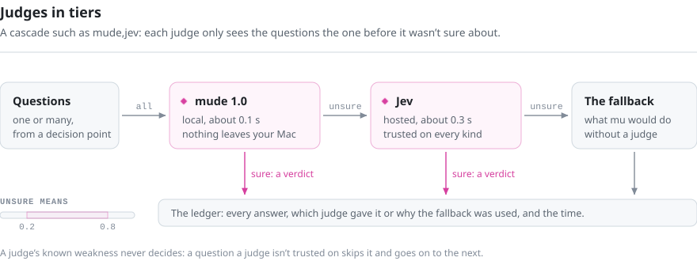
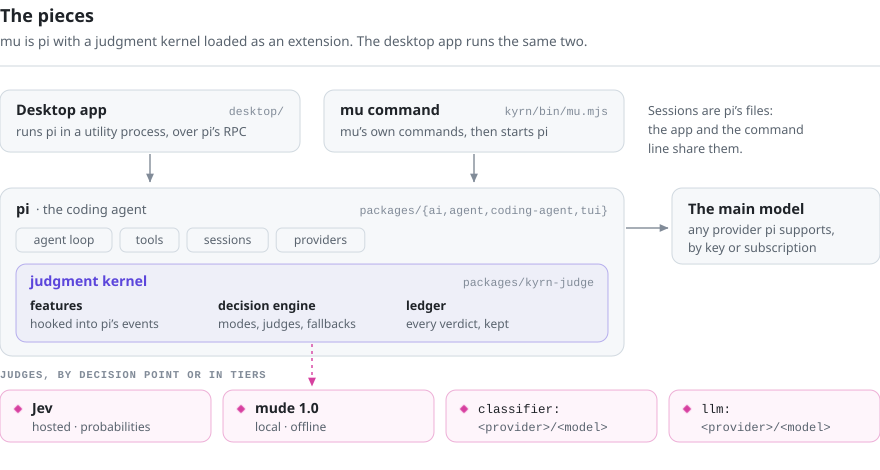

<p align="center">
  
</p>
<h1 align="center">mu</h1>
<p align="center">μ · Only what's needed.</p>
<p align="center">A coding agent that hands its routine decisions to a small, fast judge model, so the main model can focus on the code. Built on <a href="https://github.com/earendil-works/pi">pi</a>.</p>

<p align="center">
  <a href="https://github.com/qybaihe/mu/actions/workflows/ci.yml"></a>
  <a href="https://github.com/qybaihe/mu/actions/workflows/desktop.yml"></a>
  <a href="https://www.npmjs.com/package/mu-agent"></a>
  <a href="https://github.com/qybaihe/mu/releases"></a>
  <a href="LICENSE"></a>
  <a href="https://github.com/qybaihe/mu/discussions"></a>
</p>

<p align="center">
  <b>English</b> · <a href="docs/readme/README.zh-CN.md">简体中文</a> · <a href="docs/readme/README.zh-TW.md">繁體中文</a> · <a href="docs/readme/README.ja.md">日本語</a> · <a href="docs/readme/README.ko.md">한국어</a>
</p>

<p align="center">
  <picture>
    <source media="(prefers-color-scheme: dark)" srcset="docs/readme/run-dark.gif">
    
  </picture>
  <br>
  <sub>A recorded run in the desktop app. The coding model's replies are scripted for the recording (it's shown as GPT-6.1 Sol), and the project and the earlier conversations in the sidebar were made up for it. The judge's verdicts, their timings and the recovery are real: the model stopped short, <code>turn.continue</code> caught it, and mu sent it back to finish.</sub>
</p>

A coding agent makes hundreds of decisions per session that aren't about the code: what goes into the context, whether a command is safe, whether a finding is worth passing to another agent, whether the work is really done. Handing these to the main model costs tokens, time and focus. Fixed rules get them wrong too often. mu hands them to a **judge**: a small, fast model that answers one bounded question at a time, at 40 decision points in the agent loop. The main model keeps its attention on the work.

mu comes as a command-line tool, `mu`, which does everything pi does and adds the judgment kernel, and as a desktop app that bundles mu and its runtime. The default judge model is Jev, hosted by TypeSafe. It answers yes/no, choice and score questions with a probability for each answer. Any judge model can take its place: the local Laya (except for approvals), your own System One server or any LLM.

What you get:

- **A lean context and a warm cache.** In the authors' own sessions, the context rarely fills: long tool output is judged chunk by chunk so only what's needed enters, and stale results are dropped without a summary. Test-log trimming, off by default, folds exact repeats: on the longest failing test logs it cut 51% of the characters, losslessly (see [Measured](#measured)). Before the prompt cache expires, the kernel predicts whether you'll be back and refreshes the cache if you will.
- **Permission checks that don't stop you at every step.** In *Judge mode*, the default, the judge lets through what the task clearly needs and asks you about the rest. Rules catch risky commands first, and web pages and MCP output are screened for instructions aimed at the AI before the model sees them.
- **Decisions you can audit.** Every verdict goes into a local ledger with its probabilities and timing (`mu ledger`, `/status` or the desktop app's Judge tab). Any decision point can run in shadow mode, asked and logged but changing nothing, so you can compare judges before you rely on one.

> mu is in early development (0.1.x). See [Status and limitations](#status-and-limitations).

**Contents:** [Quick start](#quick-start) · [How a turn works](#how-a-turn-works) · [Decision points](#decision-points) · [Judges](#judges) · [How mu is built](#how-mu-is-built) · [Measured](#measured) · [The hive](#the-hive) · [The board](#the-plain-language-board) · [Desktop app](#the-desktop-app) · [Command line](#command-line) · [Privacy](#privacy) · [Status](#status-and-limitations) · [Documentation](#documentation) · [Contributing](#contributing)

## Quick start

**Desktop app.** Download the installer for macOS, Windows or Linux from [Releases](https://github.com/qybaihe/mu/releases/latest), open it and paste an API key or sign in with a ChatGPT, Grok or Google subscription. There's nothing else to install.

**Command line.**

```bash
npm i -g mu-agent   # Node.js 22.19 or newer
mu setup            # connect a model
mu                  # start a session in the current directory
```

**On Nebius Token Factory with NVIDIA Nemotron.** Paste a Token Factory key into `mu setup`: mu starts on Nemotron 3 Super and offers Nemotron 3 Ultra as the judge. This is new and not yet in the npm package, so run mu from source for now; [docs/nebius.md](docs/nebius.md) has the steps, the measurements behind the choice of models, and a Nemotron 3 Nano 4B judge, fine-tuned for mu, that runs on your machine.

You don't need a judge key to start: until you set one, the free Jev on OpenCode Zen answers. From the start, 34 of the 40 decision points act on their verdicts (summary-free compaction and mid-stream correction are off until you turn them on, the subagent patch scope check is off, and notification routing, mid-run messages and the drift check are only recorded), and every verdict is logged (`/status`, `mu ledger` or the app's Judge tab). To record what the judge would do without acting on it, put `{"modes": {"default": "shadow"}}` in `~/.mu/agent/mu.json`. More in [Getting started](docs/getting-started.md).

## How a turn works

<p align="center">
  <picture>
    <source media="(prefers-color-scheme: dark)" srcset="docs/readme/turn-dark.svg">
    
  </picture>
</p>

Each name in the diagram is a decision point, asked as a short question about a small piece of state. Its verdict steers what happens next. Rules set the floor: they catch a dangerous-looking command first, and the judge can only clear it by confirming you asked for it.

## Decision points

Each decision point is `active` (the default), `shadow` (asked and logged, but changes nothing; useful for comparing judges before you switch one on) or `off`. Each can also name its own judge: `jev`, `laya` (local), `classifier:<provider>/<model>`, `llm:<provider>/<model>` or a cascade such as `laya,jev`.

The 40 points fall into five groups:

- **Input** (3): what kind of message this is, whether it changes the task and whether it should interrupt the current step.
- **Context** (14): what enters the prompt (skills, packs, lessons, chunks of tool output), what to drop as the context grows, which lessons and skills are worth keeping and when to keep the prompt cache warm.
- **Tools and safety** (10): whether a command or action should run, whether fetched content or an MCP tool description carries a prompt injection, and quick calls for file search, bulk yes/no questions, browser steps, review triage and diagnostics.
- **Turn** (8): whether the work has drifted, hit a dead end, really finished or stopped short, whether a `/goal` condition is met and what the board and the model should hear.
- **Teamwork** (5): which subagent gets a delegated task, whether its patch stayed in scope and which findings bees share.

<details>
<summary><b>Input</b>: 3 decision points</summary>

| Decision point | Question | Effect |
| --- | --- | --- |
| `input.preflight` | What kind of message is this, and how much thinking does it need? | A one-line hint to the model; optionally, the turn's thinking level |
| `task.frame` | Is this a new task, a hard constraint, a correction, a subgoal or no change? | Only a change rewrites the task frame: the goal, your constraints verbatim with their source, and the acceptance criteria |
| `input.interjection` | You send a message while the agent is working: interrupt now, or after this step? | The turn is cut short, or the message waits |

</details>

<details>
<summary><b>Context</b>: 14 decision points</summary>

| Decision point | Question | Effect |
| --- | --- | --- |
| `skills.disclosure` | Which skills are relevant to this task? | Only those enter the prompt; the rest can still be found |
| `capability.disclosure` | Does this task need an installed pack or MCP server? | Only then is it opened and its process started |
| `tool.admission` | For each chunk of a long tool output: does it matter now? | What matters enters the context; the rest is archived behind a pointer |
| `tool.admission.test-log` | What in this test log is repetition? | Exact repeats are folded losslessly; optionally, the judge chooses what to keep from the rest |
| `context.forget` | Past a context threshold: which tool results are stale? | Each stale result becomes a one-line tombstone in outgoing requests |
| `context.compact` | Keep or prune this passage? | Off by default. Compaction by judgment; no summary is written |
| `memory.recall` | Which lessons apply to this task? | They're brought into the turn |
| `memory.capture` | Does this message correct the agent or set a rule? | It becomes a lesson |
| `memory.outcome` | The agent went in circles and found a way out: does that deserve a lesson? | A lesson learned from the run, not from you |
| `memory.worth` | The model or a subagent proposes a lesson: useful again, a one-off or already known? | Kept or dropped |
| `memory.merge` | Is it the same as an existing lesson, more precise or contradictory? | No duplicates; the more precise lesson replaces the older one |
| `memory.applied` | Were the recalled lessons followed this turn? | A lesson that's often recalled and never followed is retired |
| `skill.capture` | A long run ended well: was it a procedure, the same steps for the next task of its kind? | It's drafted as a skill and waits for you; `/skills accept` installs it |
| `cache.warming` | Will you be back before the prompt cache expires? | The cache is refreshed, or left to expire |

</details>

<details>
<summary><b>Tools and safety</b>: 10 decision points</summary>

| Decision point | Question | Effect |
| --- | --- | --- |
| `tool.risk` | The rules flagged a command: did you ask for it? | If the judge is unsure, mu asks you |
| `tool.approval` | In *Judge mode*: does the task clearly need this command, this change outside the project, this external action or this subagent? | Only what the judge is sure of runs; everything else asks you |
| `tool.constraint` | Before a call that changes something: does it cross a constraint you stated? | The call is stopped |
| `tool.injection` | Passage by passage, in a web page, a search result, an MCP server's output or something a command fetched from another machine (`curl`, `gh issue view`): is there an instruction aimed at the AI? | Those passages never reach the model; a note marks where each one was. A subagent that read such passages hands back its report under a warning |
| `tool.description` | When an MCP tool's description first appears or changes: does it ask the AI for more than calling the tool (reading secrets, sending data elsewhere, hiding something from you)? | The tool is removed from the model's list, calls to it are refused, and you're told |
| `files.locate` | Which files match your description? | Ranked candidates, instead of a string of greps |
| `judge.items` | The model's own yes/no question, asked about each of many items: files, log lines, findings | A probability per item through the `judge_items` tool, instead of reading them all |
| `browser.step` | Observe, judge once, act: what's the next action, and on which element? | The built-in browser moves one step |
| `review.triage` | For each `/review` finding: does it change behavior, and is it about this change? | Findings ranked P0 to P3 |
| `diagnostics.delivery` | New language-server diagnostics after an edit: report them now, at the next pause or never? | Errors reach the model; style warnings don't |

</details>

<details>
<summary><b>Turn</b>: 8 decision points</summary>

| Decision point | Question | Effect |
| --- | --- | --- |
| `turn.drift` | Every few steps: does the work still serve the goal? | Rules catch the agent going in circles; the judge catches drift |
| `turn.rewind` | The same failure, again and again: is this approach a dead end? | Back to a checkpoint |
| `turn.completion` | The model says it's done: did anything verify that? | One nudge if not |
| `turn.continue` | The run ends on "Let me run the tests next", or on a request for a go-ahead on work you already asked for: did it stop short? | It's sent back to work, at most twice per message, and never toward a step that's hard to undo |
| `output.drift` | While the model is writing: does the tail of its output cross your constraints? | Experimental and off by default; corrected mid-stream |
| `goal.met` | In goal mode, when the main model gives no answer: is the condition met? | The fallback for `/goal` |
| `board.read` | Where do things stand? Asked as multiple choice | Feeds the plain-language board |
| `notify.routing` | An event such as the context budget running low: tell the model now, later or never? | The model hears about it at the right time |

</details>

<details>
<summary><b>Teamwork</b>: 5 decision points</summary>

| Decision point | Question | Effect |
| --- | --- | --- |
| `swarm.routing` | Which role, model tier and thinking level suit this delegated task? | The subagent that fits |
| `swarm.patch` | Did the subagent's patch stay within its task? | Judged from the task, the paths and the line counts |
| `hive.publish` | Is a bee's finding worth posting to the shared board? | Published, or kept to itself |
| `hive.deliver` | Does a note on the board matter to this bee's work? | Delivered only if it does |
| `hive.relate` | Does a new finding supersede, contradict or support an earlier one? | Corrections and disputes reach the bees that hold the old note |

</details>

Every point, with its feature switch and options: [docs/reference/decision-points.md](docs/reference/decision-points.md).

## Judges

- **Jev**, TypeSafe's hosted judge model, answers bounded questions with probabilities. mu reaches it through TypeSafe, OpenRouter, the Vercel AI Gateway, OpenCode Zen, Cloudflare Workers AI or any service that speaks the same protocol, each with its own key (`TYPESAFE_API_KEY`, `MU_JUDGE_OPENROUTER_API_KEY`, `AI_GATEWAY_API_KEY`, `OPENCODE_API_KEY`, `CLOUDFLARE_API_KEY` with `CLOUDFLARE_ACCOUNT_ID`). You can pick one in the desktop app under Settings → Judges; by default mu uses the first one whose key is set.

  With no key set, Jev 1.13 on OpenCode Zen answers, free for a limited time. What it judges goes to OpenCode, which doesn't train on it, and mu reminds you of this once a day. Set a key (`mu setup`, or Settings → Judges in the app) and mu switches to it starting with the next question.

  Measured in the authors' own sessions: a warm question takes about 0.3 s over HTTP/2, and 16 chunks of tool output are judged in a single request in 0.44 s, with the shared state billed once. Verdicts, probabilities and timings go to the ledger: run `mu ledger`, or open the Judge tab in the desktop app.
- **Laya** (local, macOS on Apple silicon) is a 322M-parameter judge that runs on your machine and never touches the network. Nothing is downloaded without your consent. It's reliable on simple predicates and weaker on meta-judgments, so run it in shadow alongside your current judge and read the ledger before you give it a decision point.
- **Any classifier model** in pi's catalog can serve as a tier: `classifier:<provider>/<model>`. Examples include Cloudflare's Clef (`clef`, `clef-flash`), the System One models on OpenRouter and the Vercel AI Gateway, or a llama.cpp classifier.
- **Any LLM** can serve as a tier: `llm:<provider>/<model>`.
- **NVIDIA Nemotron on Nebius Token Factory**: `nemotron` is Nemotron 3 Ultra with thinking off, and `nemotron-local` is Nemotron 3 Nano 4B, fine-tuned for mu's judge, served on your machine. With Nemotron 3 Super as the coding model, both of mu's model roles run on Token Factory: see [docs/nebius.md](docs/nebius.md), which also covers running commands in Token Factory Sandboxes (new, and so far tested only against a stand-in for the Sandboxes API).

Judges can be chained in tiers, cheapest first:

<p align="center">
  <picture>
    <source media="(prefers-color-scheme: dark)" srcset="docs/readme/tiers-dark.svg">
    
  </picture>
</p>

## NVIDIA Nemotron on Nebius Token Factory

With one [Token Factory](https://tokenfactory.nebius.com) key, `mu setup` puts both of mu's model roles on NVIDIA Nemotron:

- **Nemotron 3 Super writes, runs and tests the code** through mu's tools. mu's thinking levels map onto the `reasoning_effort` values Super accepts.
- **Nemotron 3 Ultra is the judge** (`nemotron`). `nemotron-think` asks it with thinking on; a few lines of config route the four decision points where that measurably decides better to it.
- **A Nemotron 3 Nano 4B fine-tuned for mu's judge runs on your own GPU** (`nemotron-local`, from [mu-judge-nemotron](https://github.com/qybaihe/mu-judge-nemotron); weights on [Hugging Face](https://huggingface.co/qybaihe/mu-judge-nemotron-nano-4b)), approving a command in about 0.1 s.

Token Factory is what made choosing these models a measurement rather than a guess. Every Nemotron it serves sat in the judge's seat on the same 1,353 held-out judge requests from mu's sessions, scored by what mu then did; only Ultra clearly beat having no judge (47.3 on real requests, Super 2.7, Lightning 15.4). We then fine-tuned Nemotron 3 Nano 4B as mu's judge, and on 4,838 held-out test requests, scored once, the 4B judge scored above Ultra (68.2 against 54.7 on real requests, 59.9 against 48.4 on constructed ones). All of it came to about $27 of Token Factory credit, with no model of our own to host. Setup, routes and the numbers with their confidence intervals: [docs/nebius.md](docs/nebius.md).

## How mu is built

<p align="center">
  <picture>
    <source media="(prefers-color-scheme: dark)" srcset="docs/readme/pieces-dark.svg">
    
  </picture>
</p>

Everything mu adds to pi is one extension, the judgment kernel in `packages/kyrn-judge`. mu's changes to pi itself are kept small and marked, so upstream pi changes merge cleanly; a workflow pulls them in every Monday. The `mu` command handles mu's own commands (`setup`, `ledger`, `import`…) and starts pi with the kernel. The desktop app runs the same pi and kernel in a utility process, so the app and the command line share their sessions.

Every decision point takes the same path, and a feature acts on a verdict only in `active` mode:

<p align="center">
  <picture>
    <source media="(prefers-color-scheme: dark)" srcset="docs/readme/decision-dark.svg">
    
  </picture>
</p>

The code map, and where each step lives: [docs/architecture.md](docs/architecture.md).

## Measured

The numbers below come from the repository's own replay script, [`kyrn/spikes/judge-bench/test-log-replay.ts`](kyrn/spikes/judge-bench/test-log-replay.ts). The method and the full tables are in [kyrn/docs/09-test-log-admission.en.md](kyrn/docs/09-test-log-admission.en.md).

**Exact repeats.** A failing run often prints the same diff, DOM dump or stack trace once per failed test. mu keeps the first copy and replaces each later copy with a single line naming the lines it repeats. No model is called. The markers expand back to the original byte for byte, and the full log stays on disk, behind a pointer at the end of the output.

<p align="center">
  <picture>
    <source media="(prefers-color-scheme: dark)" srcset="docs/readme/bench-test-log-repeats-dark.svg">
    
  </picture>
</p>

<p align="center"></p>

**Goal-aware selection.** With a verbose reporter, what's worth keeping depends on what you asked for. Passing tests are noise when you're debugging a failure, and evidence when you ask which tests ran. In a single request, the judge is asked about each block of passing tests and each block of test output: does the goal still need it? The summary and the failures are never put to the judge. A block is left out only when the judge gives "not needed" a probability of 0.9 or higher. In these measurements, the judge is Jev.

<p align="center">
  <picture>
    <source media="(prefers-color-scheme: dark)" srcset="docs/readme/bench-test-log-judge-dark.svg">
    
  </picture>
</p>

*Perfect judge* reads the labels, so it shows the most a correct judge could cut. *Keep failures only* is a judge that always answers "leave it out", which is effectively what a goal-blind filter does. The study's 282 live Jev requests cost about $0.017 in total at list price; with the default wording, the median request took 345 ms.

Both are off by default. To fold repeats, set `"features": { "admission": { "testLog": "rules" } }` in `~/.mu/agent/mu.json`, or turn on *Test log trimming* in the desktop app's settings. Setting it to `"jev"` also asks the judge which of the remaining parts the current goal needs; `/mu mode tool.admission.test-log shadow` records that choice without acting on it.

What these numbers don't show:

- The selection cases are real Vitest, node:test and pytest output from synthetic projects, plus 13 hand-written edge cases. The goals and labels were written by the authors. The held-out goals were labeled first and run once, and nothing was changed afterward.
- They measure what reaches the model and what's lost, not whether the model then finishes the task.
- The repeats come from two days of one developer's sessions: 15 test logs, all from Vitest, of which the 7 over 4,000 characters are charted. Other test runners haven't been measured.
- There's no end-to-end comparison with pi, Claude Code or Codex on the same tasks yet.

`node kyrn/spikes/judge-bench/test-log-replay.ts` reruns every arm except Jev's in seconds, without a key. On the current code those arms come out 0.6 to 1.1 points higher than the charted numbers, which were measured on 2026-09-21. The Jev arm needs `TYPESAFE_API_KEY`.

<details>
<summary>The charts as tables</summary>

| Goal-aware selection | Tuned goals (29): cut | Required lines lost | Held-out goals (9): cut | Required lines lost |
| --- | --- | --- | --- | --- |
| mu · Jev | 40.2% | 0 of 72 | 46.4% | 0 of 19 |
| Perfect judge | 52.5% | 0 of 72 | 46.5% | 0 of 19 |
| Keep failures only | 61.9% | 9 of 72 | 59.4% | 6 of 19 |

| Real failing test log | Characters | Folded |
| --- | --- | --- |
| 5 failures, one diff each | 37,819 | 86% |
| DOM test, 4 failures | 34,115 | 44% |
| The same run, seen by a subagent | 34,115 | 44% |
| Shared stderr stack | 15,565 | 47% |
| 2 failures | 9,249 | 16% |
| 7 suites fail to parse | 4,953 | 0%: one repeat, too small to fold |
| 5 different failures | 4,004 | 0%: no repeats |
| All 7 | 139,820 | 51.0% |

</details>

## The hive

Every multi-agent system has to answer the same question: should one agent tell another what it knows? The usual answers are nothing (each agent reports only to the main agent), everything (the whole history, in a group chat or a handoff), whatever each agent's own large model decides, or fixed rules and a shared environment. In mu, the judge is the gate.

A hive is two to six bees, each with its own focus. Bees read code, run commands and browse the web, but never edit; the main model makes the changes. Each time a bee finishes a message, `hive.publish` asks once: is there a finding, a dead end, a decision or a blocker here worth sharing? If so, it goes on a shared, append-only board. For each new note, `hive.deliver` asks once per other bee: does this touch its focus? If it does, the note is delivered, marked *a finding, not an instruction*.

The board is append-only, so an earlier conclusion stays even after a later one overturns it: a bee reports that the tests won't run, then unsets an environment variable and they do. `hive.relate` decides how two notes relate: *supersedes*, *contradicts* or *supports*. When a conclusion is superseded, a correction goes to every bee that holds the old note. When two notes contradict each other, both stay, marked as a dispute; if nobody settles it within a minute, a bee is sent to verify.

<p align="center"></p>

You can watch all of this in the desktop app's Hive tab. Each bee gets a row: its role, its model and what it's doing or has just said. The map shows who delivered findings to whom, and the more findings travel along a line, the thicker it gets. Corrections and disputes have their own marks, and a line lights up the moment a finding arrives. The *Information flow* list shows the text of every delivery, and every verdict is listed too. The hive card in the conversation shows a miniature of the map and opens this tab.

One real run: 3 bees, 9 minutes, 117 candidates judged, 27 posted to the board and 16 delivered to the bees that needed them. Every verdict is in the run's log.

`/swarm` shows what each bee is doing, `/swarm stop` asks them to report now and `/swarm kill` ends them. A bee that runs out of time is asked for its report and ended if none arrives, and a watchdog handles a stuck model or tool. A hive always reports back.

## The plain-language board

Frontier models keep getting better at the work and worse at talking about it. Each generation's progress updates read more like output meant for another machine: denser, more opaque, less like a person talking. mu doesn't ask the working model to narrate itself.

With the board on (`/board`, or the switch on the desktop app's Board tab), each step the agent takes becomes one plain line on the board as soon as it finishes: a file changed, a check passed or failed, a command ran. Consecutive file reads are folded into a single line with a running count. Whenever the agent says something mid-run, `board.read` asks the judge whether it's news. If it is, a model chosen only for plain writing (`/board model`) rewrites it for a person and keeps the board's status current: what's happening now, how many checklist items are done and what's waiting on you. When a run finishes, a summary becomes the last line, with the full account kept above it, so you see what was done, not just that it's done.

<p align="center"></p>

The working model keeps its own language for the work, and the board stays readable at a glance. The board follows the permission mode, the goal and the subagents, and when the agent changes course, the wording follows. The two numbers at the top are context use and cache hit rate, the direct result of the context and cache decision points above.

## The desktop app

A desktop app with mu and its runtime built in: there's no Node.js to install and nothing to download on first launch. It has everything the command line has, plus a work panel beside the conversation:

**Board** · **Judge** (the live ledger: every verdict with its question, decision point and latency) · **Hive** · **Lessons** · **Files** · **Preview** · **Source** · **Browser** (the built-in browser the agent drives one step at a time; it shows the goal and lets you pause or stop)

<p align="center">
  <picture>
    <source media="(prefers-color-scheme: dark)" srcset="docs/readme/app-dark.png">
    
  </picture>
</p>

A bar along the bottom keeps the kernel in view: which judge answers and where it runs, how many decision points are active and, in a conversation, the verdicts so far, the latest judge latency and the context in use. The permission mode and the goal sit in the composer, and `⌘K` opens the command palette. You connect models inside the app: sign in with a ChatGPT, Grok or Google (Gemini CLI / Antigravity) subscription, or add an API key for any provider pi supports. You can import Claude Code, Codex CLI and ZCode conversations and continue them.

GitHub Actions builds the app for macOS (Apple silicon / Intel), Windows (x64 / Arm) and Linux (x64 / Arm) and publishes it under [Releases](https://github.com/qybaihe/mu/releases).

## Command line

```bash
npm i -g mu-agent
mu            # interactive session in the current directory
mu doctor     # check the installation, the judges and the connections
```

<p align="center">
  <picture>
    <source media="(prefers-color-scheme: dark)" srcset="docs/readme/cli-dark.png">
    
  </picture>
</p>

Requires Node.js 22.19 or newer. `mu -p "prompt"` runs a single prompt and prints the answer; `mu -c` continues the last session. `mu import --list` finds your Claude Code, Codex and ZCode conversations, and `mu import <file>` brings one in with its full history; importing it again later brings over what's new. `mu ledger [n]` prints what the judge decided in the last n sessions. The command line and the desktop app share accounts, settings and lessons. In the terminal, mu uses its own `mu-dark` and `mu-light` themes until you choose one in `/settings` (`system` follows your terminal's palette).

| Command | What it does |
| --- | --- |
| `/status` | Show the judges, each decision point's mode, what was kept out of the context and the latest verdicts |
| `/mu judge <judges>` | Set which judges answer, in which order: `laya`, `laya,jev`, `jev-opencode-free`, `classifier:<provider>/<model>`, `llm:<provider>/<model>` |
| `/mu route <point> <judge>` | Give one decision point its own judge |
| `/mu mode <point> <off\|shadow\|active>` | Switch one decision point's mode |
| `/frame` | Show the task frame: the goal, your constraints with their source and the acceptance criteria |
| `/goal <condition>` | Keep working until the condition holds; `/goal clear` ends it |
| `/permissions` | Choose Full access, Judge mode or Ask first |
| `/board` | Turn the plain-language board on or off |
| `/remember`, `/lessons`, `/forget` | Keep a lesson, list lessons, retire one |
| `/skills` | Show the skills mu drafted from runs, and accept or reject each |
| `/review`, `/commit` | Review the change, with findings ranked P0 to P3; write the commits |
| `/checkpoints`, `/rewind` | List checkpoints; go back to one |
| `/agents`, `/swarm` | List subagent roles; watch running subagents |
| `/browse`, `/jobs` | Open the built-in browser; list background jobs |
| `/capabilities`, `/ledger` | Show installed capabilities and which are turned on; show the latest verdicts |
| `/import-chat` | Import a Claude Code, Codex or ZCode conversation |
| `/doctor` | Check the setup and the connections |

pi's own commands (`/model`, `/thinking`, `/login`, `/resume`, `/tree`, `/fork`, `/compact`, `/export` and the rest) work as they do in pi, except that `/login` offers no Claude subscription sign-in: Anthropic doesn't allow other apps to offer one, so use an Anthropic API key. `MU_JUDGE=laya,jev mu` overrides the judges for a single run.

## Privacy

Your keys stay on your machine. mu never downloads a model or a runtime on its own; anything that needs a download asks first. The judge sees only the fields a question needs. With no key set, those fields go to the free Jev on OpenCode Zen; `mu setup --judge off` (no judge is asked; mu's features keep working on their rules), `MU_JUDGE=off` or Laya keeps everything on your machine. Every verdict is logged locally, and you can read all of them. The desktop app sends no telemetry or crash reports. Details are in [SECURITY.md](SECURITY.md#what-leaves-your-machine).

## Status and limitations

- mu is in early development. Pre-releases (0.1.x) are on npm and under [Releases](https://github.com/qybaihe/mu/releases). The authors use it every day, but names, settings and formats may still change.
- The measurements above come from the authors' own sessions and from synthetic projects. The test-log repeats cover Vitest only.
- The test-log numbers measure what reaches the model, not whether the model then finishes the task. There's no end-to-end comparison with pi, Claude Code or Codex on the same tasks yet.
- Laya, the local judge, runs only on macOS on Apple silicon, and it's weaker on meta-judgments than on simple predicates. Run it in shadow before you give it a decision point.
- Jev on OpenCode Zen is free for a limited time only.
- `output.drift` is experimental and off by default.

## Documentation

- [Getting started](docs/getting-started.md) · [Configuration](docs/configuration.md) · [Judges](docs/judges.md) · [Nebius and NVIDIA Nemotron](docs/nebius.md) · [Troubleshooting](docs/troubleshooting.md)
- Reference: [every decision point](docs/reference/decision-points.md) · [every feature and option](docs/reference/features.md) · [Changelog](CHANGELOG.md)
- For contributors: [How mu works](docs/architecture.md) · [Adding a decision point](docs/adding-a-decision-point.md) · [Translations](docs/translations.md) · [Writing style](docs/writing-style.md)

## Contributing

Bug reports, fixes, new decision points, judge measurements and translations are welcome, in English or Chinese. Start with [CONTRIBUTING.md](CONTRIBUTING.md); issues labeled [`good first issue`](https://github.com/qybaihe/mu/labels/good%20first%20issue) are a good way in.

```bash
npm install --ignore-scripts   # install dependencies without lifecycle scripts
node kyrn/bin/mu.mjs           # run mu from this checkout
npm run check                  # formatting, lint, types
./test.sh                      # tests (those that need a model are skipped without a key)
```

The desktop app lives in `desktop/`. Run `npm install` at the root first, then `bun install` and `KYRN_ROOT="$(cd .. && pwd)" bun run start` in `desktop/` to run the development build against the mu in this repository.

Everyone taking part follows the [Code of Conduct](CODE_OF_CONDUCT.md). Report security problems privately, as described in [SECURITY.md](SECURITY.md).

## Community and support

- Questions and ideas: [Discussions](https://github.com/qybaihe/mu/discussions). There's also discussion in Chinese on [linux.do](https://linux.do).
- Bugs and feature requests: [Issues](https://github.com/qybaihe/mu/issues/new/choose).
- More: [SUPPORT.md](SUPPORT.md).

If mu is useful to you, a star helps others find it.

## Credits and license

mu is under the MIT license ([LICENSE](LICENSE); the desktop app's is [desktop/LICENSE](desktop/LICENSE)). It is built on [pi](https://github.com/earendil-works/pi) (the coding agent, MIT), and we're grateful to its authors. Some decision points build on ideas from other projects: the wording of the prompt-injection screen comes from [hermes-jev-skills](https://github.com/kerpopule/hermes-jev-skills), and the continuation check (`turn.continue`) and the bulk judging tool (`judge_items`) are based on [oh-my-pi](https://github.com/can1357/oh-my-pi). Third-party code in the judgment kernel is listed in [THIRD_PARTY_NOTICES.md](packages/kyrn-judge/THIRD_PARTY_NOTICES.md).

The desktop app began as a fork of [AionUi](https://github.com/iOfficeAI/AionUi); the files it took from AionUi, listed in [desktop/APACHE-FILES.txt](desktop/APACHE-FILES.txt), stay under the Apache License 2.0 (see [desktop/NOTICE](desktop/NOTICE)).
