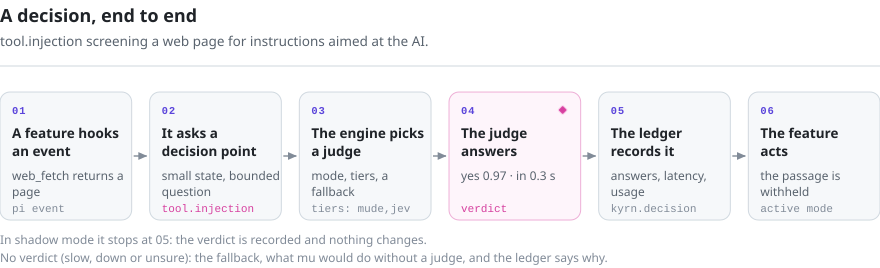

# How mu works

mu is [pi](https://github.com/earendil-works/pi), the coding agent, with a judgment kernel loaded as an extension, plus a desktop app that runs both. This page is the map: what runs where, how a decision is made and where to find the code.

## The pieces

  <picture>
    <source media="(prefers-color-scheme: dark)" srcset="readme/pieces-dark.svg">
    
  </picture>

- **The launcher**, `kyrn/bin/mu.mjs`, is the `mu` command. It handles mu's own commands (`setup`, `doctor`, `import`, `ledger`, `judge`, `auth`, `link`, `migrate`), reads the `.env` file and starts pi with the kernel as an extension. pi's own commands (`install`, `list`, `config`, `mcp`…) are passed to pi unchanged.
- **pi** does the agent's work: models and providers (`packages/ai`), the agent loop (`packages/agent`), and tools, sessions and the terminal UI (`packages/coding-agent`, `packages/tui`). mu changes pi as little as possible and marks each change, so pi's releases can be merged in.
- **The judgment kernel**, `packages/kyrn-judge`, is a pi extension. Everything mu adds lives here.
- **The desktop app**, `desktop/`, is an Electron app. It starts pi with the kernel in an Electron utility process and talks to it over pi's RPC protocol, using an in-process transport (`desktop/packages/desktop/src/process/services/nativeHost/`). The conversation list is built from pi's session files, so the app and the command line share sessions.

## A decision, end to end

  <picture>
    <source media="(prefers-color-scheme: dark)" srcset="readme/decision-dark.svg">
    
  </picture>

Take `tool.injection`, which screens web pages for prompt injection:

1. **A feature hooks an event.** `src/extension/features/injection.ts` registers a `tool_result` handler with pi. When `web_fetch` returns, the handler splits the text into passages.
2. **It asks a decision point.** `src/decisions/tool-injection.ts` defines the question with `defineDecision`: an id and a version, the questions (here, one yes/no question per passage), `buildState` (the small state the judge reads), `policy` (how answers map to an outcome) and `fallback` (what happens without a verdict).
3. **The engine decides.** `runtime.engine.decide(spec, input)` (or `decideMany` for batches) checks the point's mode, picks its judges (`tiers`, or its `route`), sends the state and the questions, and applies the policy. If a judge is slow, down or unsure, the engine returns the fallback, along with the reason.
4. **The verdict is recorded.** Every decision becomes a ledger record (`src/ledger.ts`): the outcome, whether it came from the judge or the fallback and why, the answers with their probabilities, the latency and the usage. Records are saved in the session file as `kyrn.decision` entries, which `mu ledger` and the app's Judge tab read.
5. **The feature acts**, but only in `active` mode. Here it withholds the passages judged to contain instructions and leaves a note in their place. In `shadow` mode the verdict is recorded and nothing changes.
6. **The user sees it.** Features report what they did as presentation codes (`runtime.present`, documented in [kyrn/docs/features/presentation-codes.md](../kyrn/docs/features/presentation-codes.md)): a stable code with its parameters, plus English text. The desktop app renders each code in its 13 languages; the terminal shows the text.

Every decision point follows these principles:

- **Small state, bounded question.** The judge reads summaries and metadata, not bulk text, and answers yes/no, a closed choice (always with an escape answer such as `unclear`) or a score.
- **A safe fallback.** Without a verdict, mu does what it would do without a judge.
- **No new questions for you.** A verdict never makes the model ask you something; only the permission checks, `tool.risk` and `tool.approval`, decide whether mu asks you.
- **Shadow first.** A point earns `active` with numbers from real sessions.

## Code map

| Path (under `packages/kyrn-judge/src/`) | What |
| --- | --- |
| `decision.ts` | `defineDecision`, the engine, modes |
| `decisions/` | One file per decision point: questions, state, policy, fallback |
| `extension/kyrn-judge.ts` | The extension's entry point: the feature table, in registration order |
| `extension/runtime.ts` | What features share: the engine, options, per-turn state, presentation |
| `extension/features/` | One file per feature: the pi events it hooks and what it does with verdicts |
| `providers/`, `cascade.ts`, `registry.ts` | Judges, and how tiers are chained |
| `ledger.ts` | Ledger records |
| `config.ts` | `mu.json`, built-in judges, environment overrides |
| `manifest.ts`, `../i18n/manifest.json` | The settings manifest the desktop app renders (decision points, features and options, in 13 languages) |
| `admission/`, `compaction/`, `memory/`, `hive/`, `swarm/`, `board/`, `browser/`, `permissions/`, `mcp/`, `lsp/` … | Modules for the larger features |

| Path (under `desktop/packages/desktop/src/`) | What |
| --- | --- |
| `process/services/nativeHost/` | Runs pi and the kernel in a utility process; the reducer that turns pi's events into the conversation |
| `common/kyrn/` | Types shared by the app's processes (the native bridge contract, hive and board types) |
| `renderer/pages/conversation/KyrnPanel/` | The work panel: the Board, Judge, Hive and Lessons tabs |
| `renderer/pages/settings/KyrnSettings/` | Settings rendered from the kernel's manifest |
| `renderer/services/i18n/locales/` | The app's 13 languages |

## Design notes

The reasoning behind most features, with measurements, is in [kyrn/docs/](../kyrn/docs/) (mostly in Chinese). A few to start with:

- [04-injection-points.md](../kyrn/docs/04-injection-points.md): every point where the judge is wired into the harness.
- [09-test-log-admission.en.md](../kyrn/docs/09-test-log-admission.en.md): the test-log study behind the README's numbers (English translation; [Chinese original](../kyrn/docs/09-test-log-admission.md)).
- [features/](../kyrn/docs/features/): permissions, goal mode, the board, the lessons library, checkpoints, the built-in browser and subagents.
