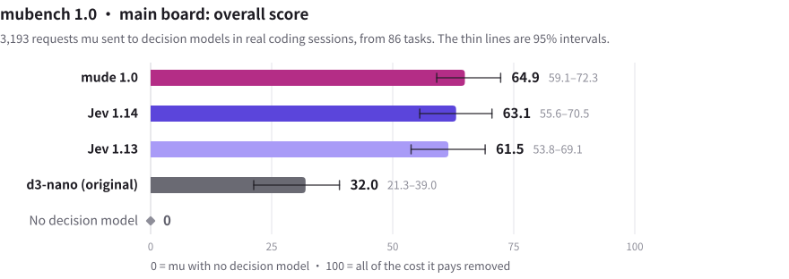
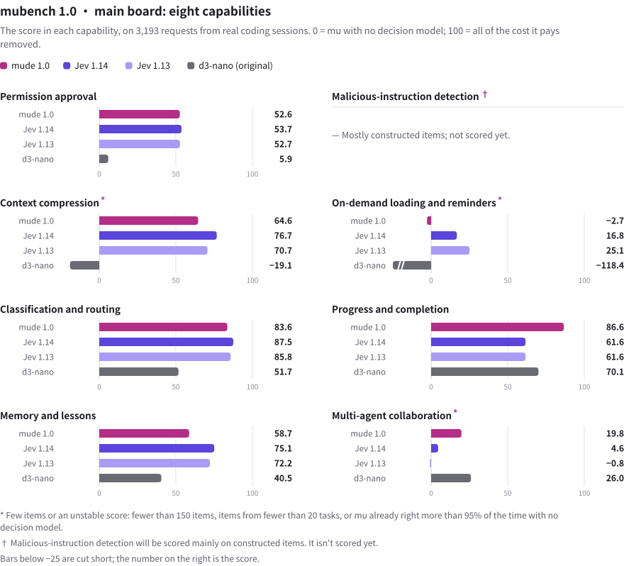
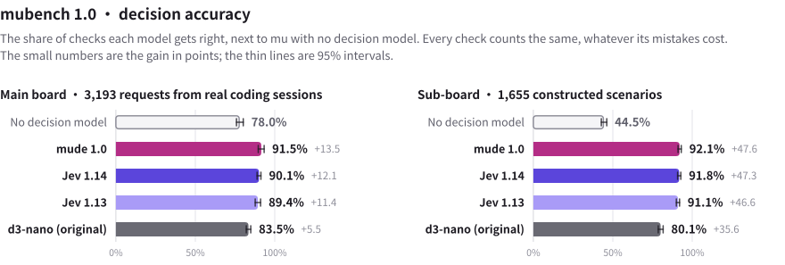

<p align="center">
  
</p>
<h1 align="center">mu</h1>
<p align="center">コーディングエージェントが下す判断の多くは、コードではなく Yes/No の問いです。mu はそのうち 40 種類を小さなモデルに任せます。ベースは <a href="https://github.com/earendil-works/pi">pi</a>。</p>

<p align="center"><b>Terminal-Bench 2.1、同じモデル・同じタスクで：</b>mu の試行の成功率は 68.2%、pi は 58.7%（9.5 ポイント高く、95% 区間は +3.8〜+15.2）。<a href="#実測">測り方</a></p>

<p align="center"><code>npm i -g mu-agent &amp;&amp; mu setup &amp;&amp; mu</code> · Node.js 22.19 以降 · macOS、Windows、Linux 向けの<a href="https://github.com/qybaihe/mu/releases/latest">デスクトップアプリ</a>もあります</p>

<p align="center">
  <a href="https://github.com/qybaihe/mu/actions/workflows/ci.yml"></a>
  <a href="https://github.com/qybaihe/mu/actions/workflows/desktop.yml"></a>
  <a href="https://www.npmjs.com/package/mu-agent"></a>
  <a href="https://github.com/qybaihe/mu/releases"></a>
  <a href="../../LICENSE"></a>
  <a href="https://github.com/qybaihe/mu/discussions"></a>
</p>

<p align="center">
  <a href="../../README.md">English</a> · <a href="README.zh-CN.md">简体中文</a> · <a href="README.zh-TW.md">繁體中文</a> · <b>日本語</b> · <a href="README.ko.md">한국어</a>
</p>

<p align="center">
  <picture>
    <source media="(prefers-color-scheme: dark)" srcset="run-dark.gif">
    
  </picture>
</p>

この出力は読む価値があるか。このコマンドはこのタスクで通していいか。作業は本当に終わったか。コーディングエージェントは 1 回のセッションで、こうした問いに何百回も答えます。大きなモデルや固定のルールに任せると、そのつけは三つの形で回ってきます。

- **トークンの無駄。** 2,000 行のテストログが丸ごとコンテキストに入り、その後のリクエストのたびに、また料金がかかります。mu の判定器は長い出力をチャンクごとに読み、タスクに必要な部分だけを入れます。残りはポインターの先に保管されます。古くなった結果は要約せずに捨て、あなたが戻ってきそうなら、プロンプトキャッシュが切れる前に更新します。テストログの圧縮（既定ではオフ）は、完全な繰り返しを 1 バイトも失わずにまとめます。Jest の失敗ログでは文字数の 40%、実際の失敗テストログ 71 件全体では 19.5% を削りました（[実測](#実測)を参照）。
- **読まずに押す「許可」。** エージェントが一歩ごとに確認してくるので、内容を読まずに許可を押し続けるか、確認自体を切ってしまう。既定の*判定モード*では、タスクに明らかに必要なものは判定器が通し、それ以外だけをあなたに確認します。危険なコマンドは先にルールが止め、Web ページと MCP の出力からは、モデルが読む前に AI 向けの指示が取り除かれます。
- **途中で止まる実行。** 「次にテストを実行します」と言って、そのターンが終わる。判定器は、途中で止まった実行や、何も検証していない「完了」を見つけて、エージェントを作業に戻します。

こうした問いを一つずつ大きなモデルに聞けば、トークンと注意力を消費します。固定のルールでは、間違いが多すぎます。mu は**判定器**に聞きます。判定器は小さくて速いモデルで、答えの範囲が決まった問いに一度に一つずつ答えます。判定ポイントはエージェントのループに 40 あり、そのうち 34 は最初から判定どおりに動きます。すべての判定は確率と所要時間とともにローカルの台帳に残ります（`mu ledger`、`/status`、デスクトップアプリの判定タブ）。どの判定ポイントもシャドーモードで動かせます。問い合わせて記録するだけで何も変えないので、判定器を比べてから任せられます。

- **mu**：コマンドライン版です。pi にできることすべてに、判定カーネルが加わります。
- **mu デスクトップ**：mu とそのランタイムを内蔵したデスクトップアプリです。ダウンロードしてモデルをつなげば、すぐに始められます。
- **判定モデル**：既定は TypeSafe がホストする Jev です。Yes/No、選択、スコアの問いに答え、答えごとに確率を付けます。すべての判定は台帳に残ります。Mac で動く mu 自身のモデル mude 1.0、Hugging Face のほかの意思決定モデル、自分で動かす System One サーバー、任意の LLM など、どの判定モデルでも Jev の代わりを務められます。

**目次：**[クイックスタート](#クイックスタート) · [1 ターンの流れ](#1-ターンの流れ) · [判定ポイント](#判定ポイント) · [判定器](#判定器) · [実測](#実測) · [ハイブ](#ハイブ) · [わかりやすいボード](#わかりやすいボード) · [デスクトップアプリ](#デスクトップアプリ) · [コマンドライン](#コマンドライン) · [ドキュメント](#ドキュメント) · [コントリビュート](#コントリビュート)

## クイックスタート

**デスクトップアプリ。** [Releases](https://github.com/qybaihe/mu/releases/latest) から macOS、Windows、Linux 用のインストーラーをダウンロードして開き、ChatGPT でサインインするか、任意のプロバイダーの API キーを貼り付けます。ほかにインストールするものはありません。

**コマンドライン。**

```bash
npm i -g mu-agent   # Node.js 22.19 以降
mu setup            # モデルを接続する
mu                  # 現在のディレクトリでセッションを始める
```

始めるのに判定器のキーは要りません。キーを設定するまでは、OpenCode Zen の無料の Jev が答えます。40 の判定ポイントのうち 34 が最初から判定を反映し、判定はすべて記録されます（`/status`、`mu ledger`、デスクトップアプリの判定タブ）。判定器がどうするかを記録するだけにしたい場合は、`~/.mu/agent/mu.json` に `{"modes": {"default": "shadow"}}` と書きます。詳しくは [Getting started](../getting-started.md)（英語）。

## 1 ターンの流れ

```
 あなた ──▶ input.preflight · task.frame · input.interjection
              │
              ▼
            モデル ──▶ ツール呼び出し ──▶ tool.risk · tool.constraint · tool.approval ──▶ 実行
              ▲                                                                          │
              │    tool.injection   web pages and MCP output: instructions aimed at the AI are withheld
              │    tool.admission   chunk by chunk: into the context, or archived behind a pointer
              │    context.forget · context.compact   when the context grows             │
              └──────────────────────────────────────────────────────────────────────────┘

 ターン終了 ──▶ turn.completion · turn.continue · turn.drift · turn.rewind · memory.applied · board.read · cache.warming
```

## 判定ポイント

各判定ポイントは `active`（オン、既定）、`shadow`（問い合わせて記録するが、何も変えない。判定器をオンにする前に比較するためのもの）、`off`（オフ）のいずれかで、それぞれ独自の判定器を指定できます。指定できるのは `jev`、`mude`（ローカル）、`classifier:<provider>/<model>`、`llm:<provider>/<model>`、または `mude,jev` のようなカスケードです。

**入力**

| 判定ポイント | 問い | 効果 |
| --- | --- | --- |
| `input.preflight` | どんな種類のメッセージで、どれくらい考える必要があるか？ | モデルへの 1 行のヒント。必要ならこのターンの思考レベルも決める |
| `task.frame` | 新しいタスクか、ハード制約か、訂正か、サブゴールか、それとも変化なしか？ | 変化があるときだけタスクフレームを書き直す。目標、あなたの制約（原文どおり、出どころ付き）、受け入れ条件 |
| `input.interjection` | エージェントの作業中にメッセージが届いた。いま割り込むか、このステップの後にするか？ | ターンを打ち切るか、メッセージを待たせる |

**コンテキスト**

| 判定ポイント | 問い | 効果 |
| --- | --- | --- |
| `skills.disclosure` | このタスクに関係するスキルはどれか？ | それだけをプロンプトに入れる。残りは探せば見つかる状態のまま |
| `capability.disclosure` | このタスクに、インストール済みのパックや MCP サーバーが必要か？ | 必要になったときだけ開き、そのプロセスを起動する |
| `tool.admission` | 長いツール出力のチャンクごとに：いま重要か？ | 重要なものはコンテキストへ。残りはアーカイブし、ポインタだけ残す |
| `tool.admission.test-log` | テストログのどこが繰り返しか？ | 完全に同じ繰り返しはロスレスに 1 つにまとめる。必要なら残りから判定器が選ぶ |
| `context.forget` | コンテキストがしきい値を超えたら、どのツール結果が古くなったか？ | 送信するリクエストの中で、それぞれ 1 行のトゥームストーンになる |
| `context.compact` | この一節は残すか、刈り込むか？ | 既定ではオフ。判定による圧縮。要約は書かない |
| `memory.recall` | このタスクに当てはまる教訓はどれか？ | それらをこのターンに持ち込む |
| `memory.capture` | このメッセージはエージェントへの訂正か、ルールの設定か？ | 教訓になる |
| `memory.outcome` | 堂々巡りの末に見つけた抜け道は、教訓にする価値があるか？ | あなたからではなく、実行から得た教訓 |
| `memory.worth` | モデルやサブエージェントが出した教訓：また役立つか、一度きりか、既知か？ | 残すか捨てる |
| `memory.merge` | 既存の教訓と同じか、より正確か、矛盾するか？ | 重複させない。より正確なほうが古いほうを置き換える |
| `memory.applied` | 呼び出した教訓は、このターンで守られたか？ | よく呼び出されるのに一度も守られない教訓は廃止される |
| `skill.capture` | うまく終わった長い実行：同じ手順で次の同種の作業ができる手順だったか？ | スキルとして下書きされ、あなたを待つ：`/skills accept` でインストール |
| `cache.warming` | プロンプトキャッシュが切れる前に、あなたは戻ってくるか？ | キャッシュを更新するか、切れるに任せる |

**ツールと安全性**

| 判定ポイント | 問い | 効果 |
| --- | --- | --- |
| `tool.risk` | ルールに引っかかったコマンド：あなたが頼んだものか？ | 確信がなければあなたに確認する |
| `tool.approval` | 判定モードで：このコマンド、プロジェクト外のこの変更、この外部への操作、このサブエージェントは、タスクに明らかに必要か？ | 判定器が確信したものだけ実行し、残りはあなたに確認する |
| `tool.constraint` | 何かを変更する呼び出しの前に：あなたが示した制約を越えていないか？ | 呼び出しを止める |
| `tool.injection` | Web ページ、検索結果、MCP サーバーの出力、コマンドが別のマシンから取得した内容（`curl`、`gh issue view`）を段落ごとに：AI に向けた指示が含まれていないか？ | その段落はモデルに届かず、元の場所に注記が残る。そうした段落を読んだサブエージェントの報告には警告が付く |
| `tool.description` | MCP ツール自身の説明を、初めて現れたときと変わったときに：このツールを呼ぶ以上のこと（秘密情報を読む、データを別の場所へ送る、あなたに隠す）を AI に求めていないか？ | そのツールはモデルのツール一覧から外され、呼び出しも拒否され、あなたに知らされる |
| `files.locate` | あなたの説明に合うファイルはどれか？ | grep を何度も重ねる代わりに、候補を順位付けする |
| `judge.items` | モデル自身の「はい／いいえ」の問いを、多数の項目（ファイル、ログ行、指摘）それぞれについて | `judge_items` ツールで項目ごとに確率を返し、全部を読まずに済む |
| `browser.step` | 観察、1 回の判定、操作：次の操作は何で、どの要素に対してか？ | 内蔵ブラウザが 1 ステップ進む |
| `review.triage` | `/review` の各指摘について：動作を変えるものか、今回の変更に関するものか？ | 指摘を P0〜P3 で順位付けする |
| `diagnostics.delivery` | 編集後に出た新しい言語サーバーの診断：いま伝えるか、次の区切りで伝えるか、伝えないか？ | エラーはモデルに届け、スタイルの警告は届けない |

**ターン**

| 判定ポイント | 問い | 効果 |
| --- | --- | --- |
| `turn.drift` | 数ステップごとに：作業はまだ目標に向かっているか？ | 堂々巡りはルールが、脱線は判定器が捉える |
| `turn.rewind` | 同じ失敗が何度も続く：このやり方は行き止まりか？ | チェックポイントまで戻る |
| `turn.completion` | モデルが終わったと言う：何かでそれを確かめたか？ | 確かめていなければ一度だけ促す |
| `turn.continue` | 「次にテストを実行します」で終わった、あるいは頼まれた作業について進めてよいかを尋ねて終わった：手前で止まっていないか？ | 作業に戻す。1 メッセージにつき最大 2 回で、取り消しにくい手順には向かわせない |
| `output.drift` | モデルが書いている最中に：出力の末尾があなたの制約を越えていないか？ | 既定ではオフ。書いている途中で修正する |
| `goal.met` | 目標モードで大きなモデルが答えを出せないとき：条件は満たされたか？ | `/goal` のフォールバック |
| `board.read` | 状況はどこまで進んだか（選択式）？ | わかりやすいボードの材料になる |
| `notify.routing` | コンテキスト予算のようなイベント：モデルにいま伝えるか、後で伝えるか、伝えないか？ | 適切なタイミングでモデルに伝わる |

**連携**

| 判定ポイント | 問い | 効果 |
| --- | --- | --- |
| `swarm.routing` | 委任したこのタスクには、どの役割、どのモデルのランク、どの思考レベルか？ | ぴったりのサブエージェント |
| `swarm.patch` | サブエージェントのパッチはタスクの範囲に収まっているか？ | タスク、パス、行数から判定する |
| `hive.publish` | ビーの発見は共有ボードに載せる価値があるか？ | 公開するか、手元にとどめる |
| `hive.deliver` | ボード上のメモは、このビーの作業に関係があるか？ | 判定器が関係ないと確信したとき以外は届ける |
| `hive.relate` | 新しい発見は、以前の発見を覆すか、矛盾するか、裏付けるか？ | 訂正と対立が、古いメモを持つビーに届く |

各判定ポイントの機能スイッチとオプション：[docs/reference/decision-points.md](../reference/decision-points.md)（英語）。

## 判定器

- **Jev**（クラウド）。TypeSafe がホストする判定モデルで、範囲の決まった問いに確率付きで答えます。TypeSafe、OpenRouter、Vercel AI Gateway、OpenCode Zen、Cloudflare Workers AI、または同じプロトコルを話す任意のサービスから呼び出せて、サービスごとにキーを持ちます（`TYPESAFE_API_KEY`、`MU_JUDGE_OPENROUTER_API_KEY`、`AI_GATEWAY_API_KEY`、`OPENCODE_API_KEY`、`CLOUDFLARE_API_KEY` と `CLOUDFLARE_ACCOUNT_ID`）。デスクトップアプリの「判定器」ページで選べて、既定ではキーが設定されている最初のものを使います。キーが一つもなければ、OpenCode Zen 上で期間限定無料の Jev 1.13 が答えます。判定に必要な内容は OpenCode に送られますが、モデルの学習には使われません。mu はそのことを 1 日 1 回知らせます。キーを設定すると（`mu setup`、または「判定器」ページ）、次の問いからそのキーを使います。作者たち自身のセッションでの実測では、HTTP/2 のウォームな接続で 1 問あたり約 0.3 秒、ツール出力 16 チャンクを 1 リクエストで判定して 0.44 秒で、状態の課金は 1 回だけでした。
- **OpenAI の判定モデル** `gpt-6-luna`。OpenAI の [Decisions API](https://developers.openai.com/api/docs/guides/decisions) で、OpenAI の API キー（`MU_JUDGE_OPENAI_KEY`、または mu がすでに持っている OpenAI のキー）を使って答えます。`mu setup --judge openai` か、設定 → 判定器で選べます。
- **NVIDIA Nemotron 3 Ultra** `nemotron`。[Nebius Token Factory](https://tokenfactory.nebius.com) で、Token Factory の API キー（`NEBIUS_API_KEY`、または `mu setup` が保存したキー）を使って答えます。`mu setup --judge nemotron` で選べます。Token Factory のキーで `mu setup` を実行すると、メインモデルも Nemotron 3.5 Super VL になり、mu の二つのモデルがどちらも Token Factory で動きます。`nemotron-think` は Ultra に思考をオンにして尋ねます（[詳細](../judges.md#nvidia-nemotron-on-nebius-token-factory)、英語）。
- **mude 1.0**（ローカル、Apple シリコンの Mac）。mu 自身の意思決定モデルで、コーディング向けに最適化されています。`mu judge mude install` でインストールし、判定器にします。
- **Hugging Face のほかの意思決定モデル**（ローカル、Apple シリコンの Mac）。`mu judge model add <リンク>`（またはデスクトップアプリの設定の「判定器」）で、mude 1.0 と同じ形でパッケージされたモデルを追加し、判定器にします。Laya は mu に含まれなくなりました。`mu.json` にまだ Laya があると、mude 1.0 がセットアップ済みなら mude 1.0 が代わりを務め、そうでなければ残りの判定器か Jev を使い、mu が一度だけ知らせます。
- **pi のモデルカタログにある任意の分類モデル**も、階層の一つとして使えます：`classifier:<provider>/<model>`。Cloudflare の Clef（`clef`、`clef-flash`）、OpenRouter と Vercel AI Gateway の System One モデル、llama.cpp の分類モデルなど。
- **任意の LLM** も、階層の一つとして使えます：`llm:<provider>/<model>`。

作者たち自身のセッションでは、これによって次の効果が得られています。ツール出力がチャンクごとに入り、古い結果は要約なしで手放されるため、コンテキストがいっぱいになることはめったにありません。テストログの整理は既定ではオフですが、オンにすると完全な繰り返しを折りたたみ、Jest の失敗ログで文字数が 40%、実際の失敗テストログ 71 件全体で 19.5% 減りました。失われた文字はありません（[実測](#実測)を参照）。プロンプトキャッシュが切れる前に、あなたが戻ってくるかどうかをカーネルが判断し、戻ってくるならキャッシュを更新します。

### mubench 1.0：意思決定モデルの比較

mubench は、mu が意思決定モデルのために作ったベンチマークです。メインボードの問題はどれも、オープンソースのリポジトリでの実際のコーディングセッションで、mu が意思決定モデルに送ったリクエストそのままです。答えはその結果がもたらすコストで採点し、どのモデルも意思決定モデルなしの mu と比べます。0 は変わらないこと、100 はそのコストをすべてなくしたことを表します。作成したシナリオのサブボードを含むリーダーボード全体は [usemu.dev/ja/mubench](https://usemu.dev/ja/mubench/) にあります。

<p align="center">
  <picture>
    <source media="(prefers-color-scheme: dark)" srcset="../images/mubench/composite-en-dark.svg">
    
  </picture>
</p>

<p align="center">
  <picture>
    <source media="(prefers-color-scheme: dark)" srcset="../images/mubench/capabilities-en-dark.svg">
    
  </picture>
</p>

判断の正答率は、もっと素朴な別の指標です。モデルが正しく答えたチェックの割合で、間違いのコストに関係なく、どのチェックも同じ重みです。

<p align="center">
  <picture>
    <source media="(prefers-color-scheme: dark)" srcset="../images/mubench/accuracy-en-dark.svg">
    
  </picture>
</p>

## 実測

小さな判断を判定器に任せると、エージェントは仕事をより多く終えられるのか、それとも節約になるだけなのか。いまのところ測定は二つです。タスク全体をエンドツーエンドで見たものと、失敗したテスト実行のうち何がモデルに届くかを見たものです。どちらにも、何を示していないかを書いています。

### タスク全体：Terminal-Bench 2.1

同じモデル、同じタスク、同じ制限時間で、各タスクを 3 回ずつ実行しました。Terminal-Bench 2.1 で mu の試行は 68.2% が成功し、mu のベースである pi は 58.7% でした。mu はどちらの失敗も少なくなりました。終わらないまま時間切れになった試行も、最後まで進んで結果が間違っていた試行も少なくなっています。

| 88 タスク × 3 回、MiMo v2.6 Pro | mu · Jev | mu · mude プレリリース版 | pi |
| --- | --- | --- | --- |
| 成功した試行 | **264 回中 180 回（68.2%）** | 264 回中 174 回（65.9%） | 264 回中 155 回（58.7%） |
| pi との差、95% 区間 | +9.5 ポイント（+3.8〜+15.2） | +7.2 ポイント（+1.5〜+13.3） | |
| mu が pi より多く / 少なく成功したタスク | 25 / 8 | 25 / 10 | |
| 失敗した試行：時間切れで未完了 / 完了したが誤り | 65 / 19 | 71 / 19 | 81 / 28 |
| 成功 1 回あたりのエージェント時間 | 23.6 分 | 22.2 分 | 27.4 分 |
| 成功 1 回あたりのコスト | $0.067 | $0.063 | $0.069 |

この測定の範囲：

- Terminal-Bench 2.1 を Harbor 0.24.0 で実行し、各タスクに決められた制限時間を使いました。エージェントが時間切れになっても、Harbor は残された状態でテストを実行するので、時間切れでも成功する試行があります。pytorch-model-recovery は合計から除外しました。最初の実行でテスト環境がその指示を pi と mu に渡していなかったためです。記録にある 3 回では、どの構成もこのタスクに毎回成功しているので、除外しても比較は変わりません。
- どの構成も MiMo v2.6 Pro、推論レベル high です。対照は pi 1.4.0 です。mu は mu-agent 0.1.12（pi 1.3.0 ベース）で、設定は既定のままです。Jev はバージョン 1.14 です。mude の列は 24 層のプレリリース版で、同じ Mac で動かしました。mude 1.0 はそこから作った 20 層のモデルで、Terminal-Bench ではまだ実行していません。0.1.12 より後の mu も同様です。
- 各タスク 3 回、2026-10-22〜2026-10-24、Apple シリコン搭載の 16 GB Mac 1 台で実行しました。再実行はインフラの障害のときだけで、ルールは事前に決めました。Rosetta のせいで 4 タスクがどの構成でも解けないため、絶対的な成功率は x86_64 より約 4.5 ポイント低く、公開リーダーボードとは比べられません。

試行ごとの結果は [docs/benchmarks/terminal-bench-2.1.csv](../benchmarks/terminal-bench-2.1.csv)、方法は [docs/benchmarks/terminal-bench-2.1.md](../benchmarks/terminal-bench-2.1.md)（英語）にあります。mu と pi を実行した Harbor アダプターと、CSV からこの表を再計算するスクリプトは [bench/harbor/](../../bench/harbor/) にあります。

### モデルに届くもの：失敗したテストログ

以下の数字は、リポジトリに含まれるスクリプトで測ったものです。繰り返しの折りたたみは 2026-10-25 に [`test-log-repeats.ts`](../../kyrn/spikes/judge-bench/test-log-repeats.ts) で、目標に応じた選別は 2026-09-21 に [`test-log-replay.ts`](../../kyrn/spikes/judge-bench/test-log-replay.ts) で測りました。後者のオフライン比較は、現在のコードでも同じ結果になります。方法と完全な表は [kyrn/docs/09-test-log-admission.md](../../kyrn/docs/09-test-log-admission.md)（中国語）にあります。

**完全な繰り返し。** 失敗した実行は、失敗したテストごとに同じ diff、DOM ダンプ、スタックを何度も出力しがちです。mu は最初の 1 つを残し、それ以降の繰り返しを「どの行の繰り返しか」を示す 1 行に置き換えます。モデルは呼び出しません。マーカーを展開すると元のログとバイト単位で一致し、完全なログはディスクに残り、出力の末尾にその場所が示されます。どれだけ減るかはテストランナー次第です。Jest と pytest は失敗ごとに diff とスタックを丸ごと出力しますが、Vitest の既定のレポーターは繰り返しが少なめです。

<p align="center">
  <picture>
    <source media="(prefers-color-scheme: dark)" srcset="bench-test-log-repeats-dark.svg">
    
  </picture>
</p>

<p align="center"></p>

**目標に応じた選択。** 詳細なレポーターでは、何を残すべきかはあなたが何を尋ねたかによります。失敗をデバッグしているとき、成功したテストはノイズですが、どのテストが実行されたかを尋ねたときには証拠です。判定器は 1 回のリクエストで、成功したテストのブロックとテスト出力のブロックそれぞれについて「目標にまだ必要か」を問われます。サマリーとすべての失敗は問いの対象になりません。判定器が「不要」に 0.9 以上の確率を付けたブロックだけが省かれます。この測定での判定器は当時の既定だった Jev 1.13 で、Jev 1.14 では再実行していません。

<p align="center">
  <picture>
    <source media="(prefers-color-scheme: dark)" srcset="bench-test-log-judge-dark.svg">
    
  </picture>
</p>

*Perfect judge*（完璧な判定器）はラベルを直接読みます。正しい判定器が省ける上限です。*Keep failures only*（失敗だけを残す）は常に「省く」と答える判定器で、目標を見ないフィルターがすることと同じです。この調査で実際に送った Jev のリクエストは全部で 282 件、定価で約 $0.017 でした。既定の問い方では、1 リクエストの所要時間の中央値は 345 ms です。

どちらも既定ではオフです。`~/.mu/agent/mu.json` に `"features": { "admission": { "testLog": "rules" } }` と書くか、デスクトップアプリの設定で「テストログの削減」をオンにすると、繰り返しが折りたたまれます。`"jev"` にすると、残った部分のうち今の目標に必要なものを判定器が選びます。`/mu mode tool.admission.test-log shadow` とすると、選択は記録されるだけになります。

これらの数字が示していないこと：

- 選択のケースは、合成プロジェクトで実際に出力された Vitest、node:test、pytest のログに、手書きの境界ケース 13 件を加えたものです。目標とラベルは作者たちが書きました。調整に使っていない目標は先にラベルを付け、1 回だけ実行し、その後は何も変えていません。
- 測っているのは、何がモデルに届き何が失われたかであって、その後モデルがタスクをやり遂げたかではありません。
- 折りたたみのサンプルは主に CI のログです。オープンソースの 12 プロジェクト（測る前にテストランナーで選びました）からは直近の失敗した実行を 6 回ずつ、mu 自身の CI からは 2026-09-22 以降の失敗したテスト実行を取りました。1 回の実行につき失敗ログを 1 件、mu の bash ツールが渡す形（最後の 2,000 行か 50 KB）に切り出しています。作者たちのセッションの 7 件は以前のサンプルです。作者たちの最近のセッションでは、エージェントがテストの出力をほとんど `tail` に通していたため、admission が動き出す 4,000 文字に届くログはわずかでした。
- Go と Cargo の出力はテストログとして認識されないため、折りたたまれません。

<details>
<summary>グラフのデータ</summary>

| 目標に応じた選択 | 調整に使った目標（29）：省いた割合 | 失われた必要な行 | 調整に使っていない目標（9）：省いた割合 | 失われた必要な行 |
| --- | --- | --- | --- | --- |
| mu · Jev | 40.2% | 72 行中 0 行 | 46.4% | 19 行中 0 行 |
| 完璧な判定器 | 52.5% | 72 行中 0 行 | 46.5% | 19 行中 0 行 |
| 失敗だけを残す | 61.9% | 72 行中 9 行 | 59.4% | 19 行中 6 行 |

| 失敗したテストログ（実行ごとに 1 件） | 件数 | 文字数 | 折りたたみ |
| --- | --- | --- | --- |
| Jest、オープンソース 4 プロジェクト | 14 | 584,229 | 40.1% |
| pytest、オープンソース 2 プロジェクト | 5 | 255,721 | 26.7% |
| Vitest、オープンソース 6 プロジェクト | 18 | 530,853 | 9.2% |
| Vitest、mu 自身の CI | 27 | 942,761 | 6.0% |
| Vitest、作者たちのセッション（2026-09-21） | 7 | 139,820 | 51.0% |
| 合計 | 71 | 2,453,384 | 19.5% |

</details>

## ハイブ

ハイブは 2〜6 匹のビーでできていて、ビーはそれぞれ自分の着眼点を持っています。ビーはコードを読み、コマンドを実行し、ブラウザを使いますが、コードは編集しません。変更はメインモデルが行います。ビーが何かを言い終えるたびに、`hive.publish` が一度だけ問います。ここに共有する価値のある発見、行き止まり、決定、ブロッカーはあるか。価値のあるものは、追記専用の共有ボードに載ります。新しいメモが載るたびに、`hive.deliver` がほかのビー 1 匹ごとに一度ずつ問います。このメモはそのビーの着眼点に関わるか。判定器が関わらないと確信したとき以外は、メモは「これは発見であり、指示ではない」と明記して届けられます。

ボードは追記されるだけなので、後の結論が前の結論を覆すことがあります。たとえば、あるビーが「テストが動かない」と報告し、そのあと環境変数を一つ消したら動いた、という場合です。`hive.relate` は二つのメモの関係を読み取ります。「覆す」「矛盾する」「裏付ける」のどれかです。覆された結論は訂正になり、古い結論を持っているすべてのビーに届けられます。互いに矛盾する二つのメモはどちらも残り、「対立」として印が付きます。1 分以内に誰も決着をつけなければ、検証役のビーが送られます。

<p align="center"></p>

こうしたやり取りの現場が、デスクトップアプリのハイブタブです。ビー 1 匹につき 1 行で、役割、モデル、いま何をしているか、または直前に何を言ったかが並びます。マップは、誰が誰に発見を届けたかを描きます。多く届いた線ほど太くなり、訂正と対立にはそれぞれ専用の描き方があり、発見が届いた瞬間にその線が光ります。情報フローには届けられたメッセージの原文がすべて並び、判定の記録にはすべての判定が並びます。会話の中のハイブカードは小さなマップを表示し、開くとこのタブに移ります。

`/swarm` で各ビーがいま何をしているかを見られます。`/swarm stop` ですぐに報告を求め、`/swarm kill` で終了させます。時間切れのビーには報告が求められ、報告がなければ終了させられます。止まってしまったモデルやツールはウォッチドッグが処理します。ハイブは必ず戻ってきます。

## わかりやすいボード

ボードがオンのとき（`/board`、またはデスクトップアプリのボードタブのスイッチ）、エージェントが一歩進むたびに、ボードにはその場でわかりやすい一行が加わります。どのファイルを変えたか、検証が通ったか通らなかったか、どのコマンドを実行したか。ファイルを続けて読んだときは「N 個のファイルを見た」という一行にまとまり、数字が増えていきます。作業の途中でエージェントが何か言うたびに、`board.read` が判定器にそれがニュースかどうかを尋ねます。ニュースなら、わかりやすく話すという一点だけで選ばれたモデル（`/board model`）がその場で人に向けて語り直し、あわせてボードの現状も更新します。いま何をしているか、チェックリストの項目のうちいくつが終わったか、あなたの確認を待っているものは何か。実行が終わったときのまとめは記録の最後の一行になり、経過はその上に残ります。「終わった」だけでなく、何をしたのかが必ず見えます。

<p align="center"></p>

ボードは権限モード、目標、サブエージェントに合わせて変わり、エージェントが進め方を変えれば、言い回しも変わります。上部の二つの数字はコンテキストの使用量とキャッシュヒット率です。

## デスクトップアプリ

mu とそのランタイムを内蔵したデスクトップアプリです。Node のインストールは不要で、初回起動時にも何もダウンロードしません。コマンドラインにあるものはすべて揃っていて、さらに会話の横に作業パネルがあります。

**ボード** · **判定**（リアルタイムの台帳：すべての判定とその問い） · **ハイブ** · **教訓** · **ファイル** · **プレビュー** · **ソース** · **ブラウザ**（エージェントが一歩ずつ操作する内蔵ブラウザ。目標、一時停止、停止付き）

<p align="center">
  <picture>
    <source media="(prefers-color-scheme: dark)" srcset="app-dark.png">
    
  </picture>
</p>

画面下部のバーで、カーネルの状態をいつでも確認できます。どの判定器が答えていてどこで動いているか、有効な判定ポイントの数、会話中ならそれまでの判定数、直近の判定の所要時間、コンテキストの使用量です。権限モードと目標は入力欄にあり、`⌘K` でコマンドパレットが開きます。モデルへのログインはアプリの中で行います。ChatGPT でサインインするか、pi が対応する任意のプロバイダーの API キーを使えます。Claude Code、Codex CLI、ZCode の会話は、インポートして続きから話せます。

macOS（Apple シリコン / Intel）、Windows（x64 / Arm）、Linux（x64 / Arm）向けのビルドは GitHub Actions で作成し、[Releases](https://github.com/qybaihe/mu/releases) で公開しています。

## コマンドライン

```bash
npm i -g mu-agent
mu            # カレントディレクトリで対話セッションを始める
mu doctor     # インストール、判定器、各接続を確認する
```

<p align="center">
  <picture>
    <source media="(prefers-color-scheme: dark)" srcset="cli-dark.png">
    
  </picture>
</p>

Node 22.19 以降が必要です。`mu -p "prompt"` は 1 回だけ実行して結果を出力し、`mu -c` は前回のセッションを続けます。`mu import --list` は Claude Code、Codex、ZCode の会話を探し、`mu import <file>` はそれを履歴ごと取り込みます。あとでもう一度取り込むと、その後の新しい内容が加わります。`mu ledger [n]` は直近 n 回のセッションで判定器が下した判定を出力します。コマンドラインとデスクトップアプリは、アカウント、設定、教訓を共有します。

| コマンド | 内容 |
| --- | --- |
| `/status` | 判定器、各判定ポイントのモード、コンテキストに入れなかったもの、最新の判定 |
| `/mu judge <judges>` | どの判定器がどの順で答えるか：`jev`、`mude,jev`、`jev-opencode-free`、`openai`、`nemotron`、`classifier:<provider>/<model>`、`llm:<provider>/<model>` |
| `/mu route <point> <judge>` | 一つの判定ポイントに専用の判定器を割り当てる |
| `/mu mode <point> <off\|shadow\|active>` | 一つの判定ポイントを切り替える |
| `/frame` | タスクフレーム：目標、あなたの制約とその出どころ、受け入れ条件 |
| `/goal <condition>` | 条件が満たされるまで作業を続ける。`/goal clear` で終了 |
| `/permissions` | フルアクセス / 判定モード / 最小権限 |
| `/board` | わかりやすいボードのオン・オフ |
| `/remember`、`/lessons`、`/forget` | 教訓を一つ残す、一覧する、一つを廃止する |
| `/skills` | mu が実行から下書きしたスキル：読む、インストール、破棄 |
| `/review`、`/commit` | 変更をレビューし指摘を P0〜P3 で順位付けする、コミットを書く |
| `/checkpoints`、`/rewind` | チェックポイントを一覧する、そのどれかに戻る |
| `/agents`、`/swarm` | サブエージェントを送り出す、作業中の各ビーの様子を見る |
| `/browse`、`/jobs` | 内蔵ブラウザ、バックグラウンドジョブ |
| `/capabilities`、`/ledger` | インストール済みのケイパビリティとそのうち開いているもの、最新の判定 |
| `/import-chat` | Claude Code、Codex または ZCode の会話をインポートする |
| `/doctor` | セットアップと接続を確認する |

pi 自身のコマンド（`/model`、`/thinking`、`/login`、`/resume`、`/tree`、`/fork`、`/compact`、`/export` など）はそのままです。ただし `/login` には Claude サブスクリプションのサインインがありません（Anthropic が他のアプリによる提供を認めていないため）。Anthropic の API キーを使ってください。`MU_JUDGE=mude,jev mu` とすると、その 1 回の実行だけ判定器を上書きできます。

## プライバシー

キーはこのマシンから出ません。mu が自分からモデルやランタイムをダウンロードすることはなく、ダウンロードが必要なものは必ず先に確認します。判定器が見るのは、問いに必要なフィールドだけです（キーがなければ、それは OpenCode Zen の無料 Jev に送られます。`--local-only` を付けた mude 1.0、`mu setup --judge off`（判定器には何も問い合わせず、mu の機能はルールで動き続けます）、`MU_JUDGE=off` のどれかなら、すべてこのマシンに残ります）。すべての判定はローカルに記録され、どれでも読み返せます。

## ドキュメント

- [Getting started](../getting-started.md) · [設定](../configuration.md) · [判定器](../judges.md) · [トラブルシューティング](../troubleshooting.md)（英語）
- リファレンス：[すべての判定ポイント](../reference/decision-points.md) · [すべての機能とオプション](../reference/features.md) · [変更履歴](../../CHANGELOG.md)
- コントリビューター向け：[mu の仕組み](../architecture.md) · [判定ポイントの追加](../adding-a-decision-point.md) · [翻訳](../translations.md)

## コントリビュート

バグ報告、修正、新しい判定ポイント、判定器の評価、翻訳を歓迎します。英語か中国語で書いてください。まず [CONTRIBUTING.md](../../CONTRIBUTING.md) を読んでください。[`good first issue`](https://github.com/qybaihe/mu/labels/good%20first%20issue) ラベルの issue から始めるのがおすすめです。

```bash
npm install --ignore-scripts   # 依存パッケージのインストール（ライフサイクルスクリプトは実行しない）
npm run hydrate:model-catalog  # リポジトリに固定されたカタログからモデル一覧を生成（オフライン）
node kyrn/bin/mu.mjs           # このチェックアウトから mu を起動
npm run check                  # フォーマット、lint、型チェック
./test.sh                      # テスト（モデルが必要なテストは、キーがなければスキップ）
```

デスクトップアプリは `desktop/` にあります。`bun install` のあと、`KYRN_ROOT="$(cd .. && pwd)" bun run start` を実行すると、このリポジトリの mu を使う開発版が起動します（先にルートで `npm install` を実行してください）。

参加者は全員[行動規範](../../CODE_OF_CONDUCT.md)に従います。セキュリティの問題は [SECURITY.md](../../SECURITY.md) のとおり非公開で報告してください。

## クレジットとライセンス

mu のライセンスは MIT です（[LICENSE](../../LICENSE)。デスクトップアプリは [desktop/LICENSE](../../desktop/LICENSE)）。[pi](https://github.com/earendil-works/pi)（コーディングエージェント、MIT）をもとに作られています。pi の作者に感謝します。いくつかの判定ポイントは他のプロジェクトのアイデアをもとにしています。プロンプトインジェクション検査の問い方は [hermes-jev-skills](https://github.com/kerpopule/hermes-jev-skills) から、続行チェックと一括判定ツールは [oh-my-pi](https://github.com/can1357/oh-my-pi) にならっています。判定カーネルで使っているサードパーティのコードは [THIRD_PARTY_NOTICES.md](../../packages/kyrn-judge/THIRD_PARTY_NOTICES.md) に記載しています。

デスクトップアプリは [AionUi](https://github.com/iOfficeAI/AionUi) のフォークから始まりました。AionUi から受け継いだファイルは [desktop/APACHE-FILES.txt](../../desktop/APACHE-FILES.txt) に一覧があり、引き続き Apache License 2.0 です（[desktop/NOTICE](../../desktop/NOTICE) を参照）。

## コミュニティ

- 質問とアイデア：[Discussions](https://github.com/qybaihe/mu/discussions)。中国語のディスカッションは [linux.do](https://linux.do) でも。
- バグ報告と要望：[Issues](https://github.com/qybaihe/mu/issues/new/choose)。
- そのほか：[SUPPORT.md](../../SUPPORT.md)。
