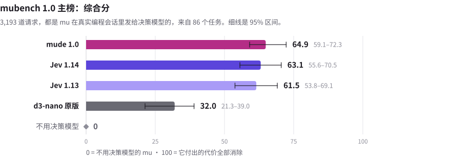
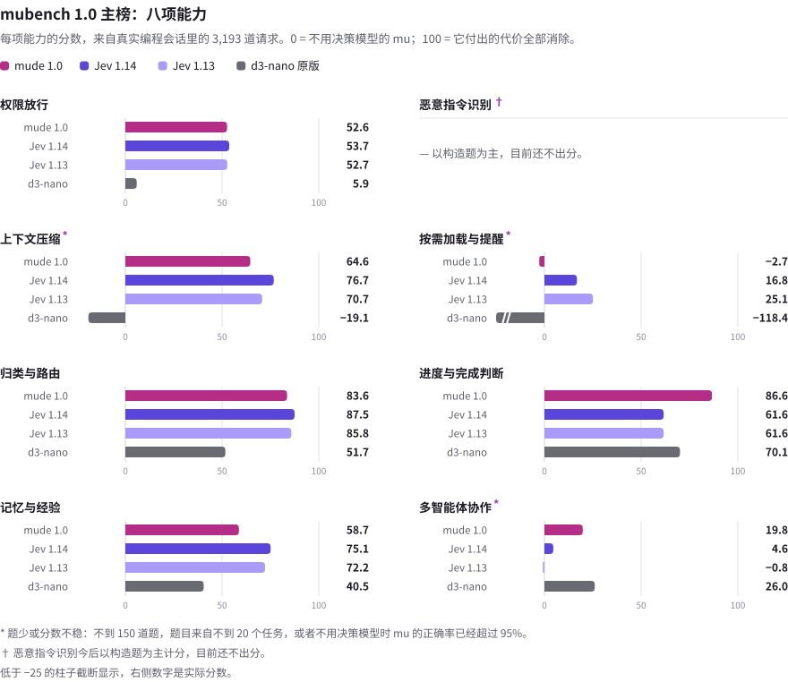
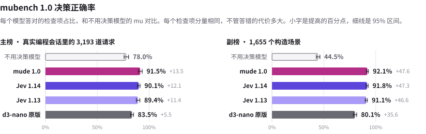
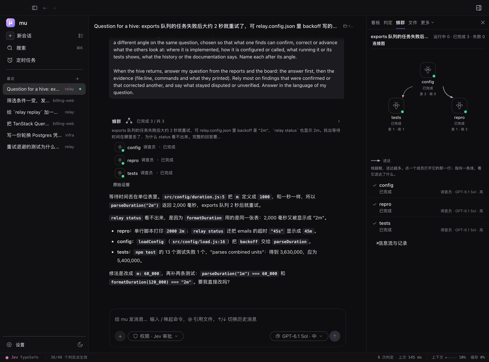
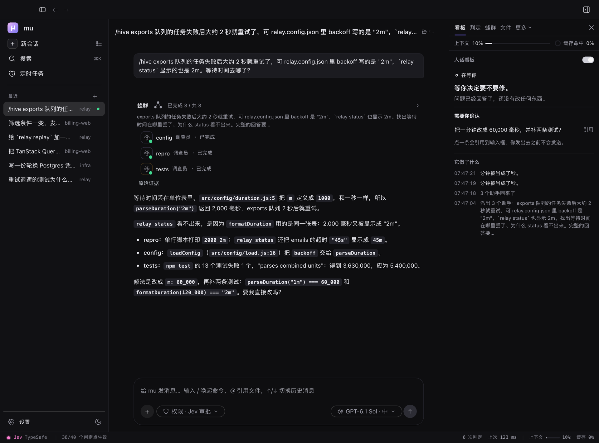
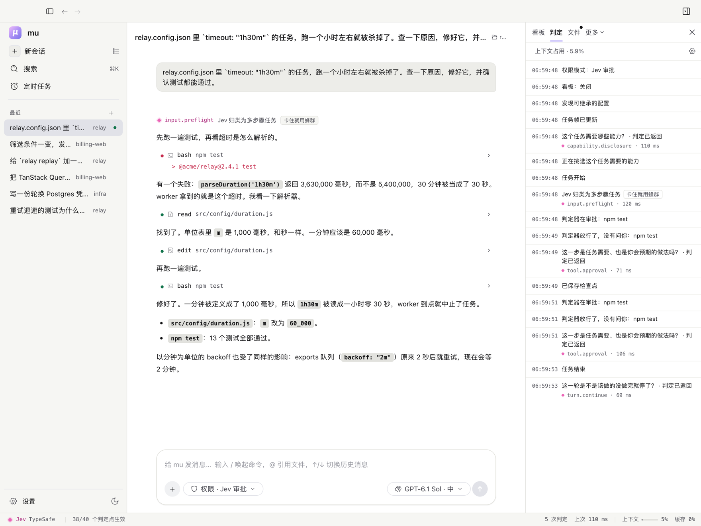

<p align="center">
  
</p>
<h1 align="center">mu</h1>
<p align="center">帶判定核心的程式設計代理。以 <a href="https://github.com/earendil-works/pi">pi</a> 為基礎。</p>

<p align="center">
  <a href="https://github.com/qybaihe/mu/actions/workflows/ci.yml"></a>
  <a href="https://github.com/qybaihe/mu/actions/workflows/desktop.yml"></a>
  <a href="https://www.npmjs.com/package/mu-agent"></a>
  <a href="https://github.com/qybaihe/mu/releases"></a>
  <a href="../../LICENSE"></a>
  <a href="https://github.com/qybaihe/mu/discussions"></a>
</p>

<p align="center">
  <a href="../../README.md">English</a> · <a href="README.zh-CN.md">简体中文</a> · <b>繁體中文</b> · <a href="README.ja.md">日本語</a> · <a href="README.ko.md">한국어</a>
</p>

<p align="center">
  <picture>
    <source media="(prefers-color-scheme: dark)" srcset="run-dark.gif">
    
  </picture>
</p>

一個程式設計代理每個工作階段要做幾百個和程式碼無關的決定：什麼留在上下文裡，一條指令安不安全，一個發現值不值得告訴另一個代理，工作做完了沒有。交給大模型，花的是 token、延遲和注意力；交給寫死的規則，錯得太多。mu 把它們交給一個**判定器**：一個小而快的模型，每次只回答一個有邊界的問題，每一輪有 40 個判定點。大模型把注意力留給正事。

- **mu**：命令列。pi 的全部能力，加上判定核心。
- **mu 桌面版**：內建 mu 和執行環境的桌面應用程式。下載，接上一個模型，開始。
- **判定器**：預設的判定模型是 Jev，由 TypeSafe 託管。是非題、選擇題、評分題，每個答案帶機率，每一次判定都記進判定帳本。任何判定模型都可以取代它：在你的 Mac 上執行的 mu 自有模型 [mude 1.0](#mude-10針對程式設計場景最佳化的決策模型)、Hugging Face 上的其他決策模型、你自己的 System One 服務，或任何一個大模型。

**目錄：**[快速開始](#快速開始) · [一輪是怎麼走的](#一輪是怎麼走的) · [判定點](#判定點) · [判定器](#判定器) · [實測](#實測) · [蜂群](#蜂群) · [人話看板](#人話看板) · [桌面版](#桌面版) · [命令列](#命令列) · [文件](#文件) · [參與貢獻](#參與貢獻)

## 快速開始

**桌面版。** 從 [Releases](https://github.com/qybaihe/mu/releases/latest) 下載 macOS、Windows 或 Linux 安裝檔，開啟後貼上一組 API 金鑰，或用 ChatGPT、Grok、Google 訂閱登入。不需要再安裝其他東西。

**命令列。**

```bash
npm i -g mu-agent   # Node.js 22.19 或更新版本
mu setup            # 接上一個模型
mu                  # 在目前目錄開一個工作階段
```

開始使用不需要判定器的金鑰：設定之前，由 OpenCode Zen 上免費的 Jev 回答。40 個判定點裡有 34 個一開始就生效，每次判定都會記錄下來（`/status`、`mu ledger`、桌面版的判定分頁）。如果只想記錄判定器會怎麼做、不改變行為，在 `~/.mu/agent/mu.json` 寫入 `{"modes": {"default": "shadow"}}`。更多請見 [Getting started](../getting-started.md)（英文）。

## 一輪是怎麼走的

```
 你 ──▶ input.preflight · task.frame · input.interjection
          │
          ▼
        模型 ──▶ 工具呼叫 ──▶ tool.risk · tool.constraint · tool.approval ──▶ 執行
          ▲                                                                   │
          │    tool.injection   web pages and MCP output: instructions aimed at the AI are withheld
          │    tool.admission   chunk by chunk: into the context, or archived behind a pointer
          │    context.forget · context.compact   when the context grows      │
          └───────────────────────────────────────────────────────────────────┘

 一輪結束 ──▶ turn.completion · turn.continue · turn.drift · turn.rewind · memory.applied · board.read · cache.warming
```

## 判定點

每個判定點可以是 `active`（生效，預設）、`shadow`（照常提問並記錄，但不改變任何行為，用來在開啟之前比較判定器）或 `off`（關閉），也可以指定自己的判定器：`jev`、`mude`（本機）、`classifier:<provider>/<model>`、`llm:<provider>/<model>`，或 `mude,jev` 這樣的串接。

**輸入**

| 判定點 | 問題 | 效果 |
| --- | --- | --- |
| `input.preflight` | 這則訊息是什麼類型，需要多深的思考？ | 給模型一行提示；也可以設定這一輪的思考等級 |
| `task.frame` | 新任務、硬性約束、糾正、子目標，還是沒有變化？ | 只有變化才重寫任務框架：目標、你的約束原話及其出處、驗收條件 |
| `input.interjection` | 代理正在工作時來了一則訊息：現在打斷，還是這一步之後？ | 這一輪被中斷，或訊息先等一下 |

**上下文**

| 判定點 | 問題 | 效果 |
| --- | --- | --- |
| `skills.disclosure` | 哪些技能和這個任務有關？ | 只有它們進提示詞；其餘仍查得到 |
| `capability.disclosure` | 這個任務需要某個已安裝的能力包或 MCP 伺服器嗎？ | 需要時才開啟、才啟動它的行程 |
| `tool.admission` | 一段長工具輸出的每一塊：現在重要嗎？ | 重要的進上下文；其餘封存，留一個指標 |
| `tool.admission.test-log` | 測試記錄裡哪些是重複？ | 完全相同的重複只留一份，無損；也可以讓判定器從剩下的裡面挑 |
| `context.forget` | 上下文超過門檻後，哪些工具結果已經過期？ | 每一條在送出的請求裡變成一行墓碑 |
| `context.compact` | 這一段留還是刪？ | 預設關閉。依判定壓縮；不寫摘要 |
| `memory.recall` | 哪些經驗適用於這個任務？ | 帶進這一輪 |
| `memory.capture` | 這則訊息是在糾正代理，還是在立一條規矩？ | 變成一條經驗 |
| `memory.outcome` | 繞了圈子之後，最後走通的那條路值得記嗎？ | 從執行中學來的經驗，不是你教的 |
| `memory.worth` | 模型或子代理提出的一條經驗：以後還用得上、一次性的，還是早就知道？ | 留下或丟掉 |
| `memory.merge` | 和已有的經驗是同一條、更精確，還是矛盾？ | 不重複記；更精確的取代舊的 |
| `memory.applied` | 這一輪召回的經驗照做了嗎？ | 常被召回卻從不照做的經驗會自動退役 |
| `skill.capture` | 一次長執行成功收尾：它是不是一套做法，同樣的步驟能做下一件同類的事？ | 起草成技能，等你決定：`/skills accept` 安裝 |
| `cache.warming` | 提示快取過期之前你會回來嗎？ | 續一次快取，或任它過期 |

**工具與安全**

| 判定點 | 問題 | 效果 |
| --- | --- | --- |
| `tool.risk` | 一條被規則標記的指令：是你要的嗎？ | 拿不準就問你 |
| `tool.approval` | 在「判定模式」下：這條指令、這個專案外的變更、這個對外動作、這個子代理，任務明確需要嗎？ | 判定器確定需要的直接放行；其餘問你 |
| `tool.constraint` | 在一個會改變東西的呼叫之前：它越過了你定下的約束嗎？ | 呼叫被攔下 |
| `tool.injection` | 網頁、搜尋結果、MCP 伺服器的輸出，或指令從別的機器取回的內容（`curl`、`gh issue view`），一段一段看：裡面有沒有衝著 AI 來的指令？ | 這些段落不會到達模型，原處留一條說明。讀到過這種段落的子代理，報告交回時前面會附一句警告 |
| `tool.description` | MCP 工具自己的說明，第一次出現或變了時：是不是要 AI 做呼叫這個工具以外的事（讀金鑰、把資料送到別處、瞞著你）？ | 這個工具從模型的工具列表裡拿掉，呼叫也會被拒絕，並告訴你 |
| `files.locate` | 哪些檔案符合你的描述？ | 為候選檔案排序，取代一連串 grep |
| `judge.items` | 模型自己提的一個是非題，對很多項逐項問：檔案、日誌行、審查發現 | 透過 `judge_items` 工具，每項得到一個機率，不用一項項讀 |
| `browser.step` | 觀察、判一次、動手：下一步操作是什麼，作用在哪個元素上？ | 內建瀏覽器走一步 |
| `review.triage` | `/review` 的每條發現：會改變程式行為嗎，是關於這次變更的嗎？ | 按 P0 到 P3 分級 |
| `diagnostics.delivery` | 一次編輯後新的語言伺服器診斷：現在說，下次停頓時說，還是不說？ | 錯誤送到模型；風格警告不送 |

**回合**

| 判定點 | 問題 | 效果 |
| --- | --- | --- |
| `turn.drift` | 每隔幾步：工作還在為目標服務嗎？ | 規則抓繞圈子，判定器抓偏離 |
| `turn.rewind` | 同一個失敗一次又一次：這條路是死路嗎？ | 退回到某個檢查點 |
| `turn.completion` | 模型說做完了：有什麼東西驗證過嗎？ | 沒有就提醒一次 |
| `turn.continue` | 一輪停在「接下來我跑一下測試」，或在你已經要它做的事上問「要我動手嗎」：是不是沒做完就停了？ | 讓它接著做，每則訊息最多兩次；難以撤銷的一步不會推它去做 |
| `output.drift` | 模型正在寫的時候：輸出的末尾越過了你的約束嗎？ | 預設關閉；邊寫邊糾正 |
| `goal.met` | 目標模式下大模型給不出答案時：條件成立了嗎？ | `/goal` 的備援 |
| `board.read` | 事情做到哪了，選擇題？ | 供人話看板使用 |
| `notify.routing` | 上下文預算之類的事件：現在告訴模型，晚點，還是不說？ | 模型在合適的時候被告知 |

**協作**

| 判定點 | 問題 | 效果 |
| --- | --- | --- |
| `swarm.routing` | 這個委派出去的任務，用哪個角色、哪一級模型、多深的思考？ | 合適的子代理 |
| `swarm.patch` | 子代理交回的修補檔留在任務範圍內嗎？ | 從任務、路徑和行數來判斷 |
| `hive.publish` | 一隻 bee 的發現值得上共享板嗎？ | 發布，或自己留著 |
| `hive.deliver` | 板上的一條筆記和這隻 bee 的工作有關嗎？ | 有關才投遞 |
| `hive.relate` | 一條新發現推翻、矛盾還是支持了早先的某一條？ | 更正和爭議送到拿著舊筆記的 bee 那裡 |

每個判定點對應的功能開關和選項：[docs/reference/decision-points.md](../reference/decision-points.md)（英文）。

## 判定器

- **Jev**：TypeSafe 託管的判定模型，回答有邊界的問題，答案帶機率。可以經 TypeSafe、OpenRouter、Vercel AI Gateway、OpenCode Zen、Cloudflare Workers AI，或任何支援同一協定的服務呼叫，每個服務有自己的金鑰（`TYPESAFE_API_KEY`、`MU_JUDGE_OPENROUTER_API_KEY`、`AI_GATEWAY_API_KEY`、`OPENCODE_API_KEY`、`CLOUDFLARE_API_KEY` 加 `CLOUDFLARE_ACCOUNT_ID`）：在桌面版的「判定器」頁選一個，預設用第一個設定了金鑰的。一把金鑰都沒有時，預設由 OpenCode Zen 上限時免費的 Jev 1.13 回答：判定要讀的內容會送到 OpenCode，它不拿來訓練模型，mu 每天提示一次。設定金鑰（`mu setup`，或「判定器」頁）後，下一個問題起就用你的金鑰。在作者自己的工作階段裡實測：HTTP/2 上一個熱連線的問題約 0.3 秒；16 塊工具輸出併成一個請求判完 0.44 秒，狀態只計費一次。
- **mude 1.0**（本機，Apple 晶片的 Mac）：mu 自己的決策模型，針對程式設計場景最佳化，見[下文](#mude-10針對程式設計場景最佳化的決策模型)。
- **Hugging Face 上的其他決策模型**（本機，Apple 晶片的 Mac）：`mu judge model add <連結>`（或桌面版設定的「判定器」頁）加入一個和 mude 1.0 同樣打包的模型，並讓它擔任判定器。mu 不再內建 Laya：`mu.json` 裡還寫著它的，mude 1.0 裝好了就由 mude 1.0 頂替，否則用剩下的判定器或 Jev，mu 會提示一次。
- **pi 模型目錄裡的任何分類模型**，作為一個層級：`classifier:<provider>/<model>`。例如 Cloudflare 的 Clef（`clef`、`clef-flash`）、OpenRouter 和 Vercel AI Gateway 上的 System One 模型、llama.cpp 的分類模型。
- **任何大模型**，作為一個層級：`llm:<provider>/<model>`。

這換來什麼，以作者自己的工作階段為準：上下文很少填滿，因為工具輸出逐塊進入、過期結果不寫摘要直接放下；測試記錄精簡預設關閉，開啟後折疊完全相同的重複，在最長的幾份失敗測試記錄裡省下 51% 的字元，一個字元也沒丟（見[實測](#實測)）；提示快取過期之前，核心會判斷你會不會回來，會回來就提前續上。

### mude 1.0：針對程式設計場景最佳化的決策模型

mude 1.0 是 mu 自己的決策模型，針對程式設計場景特別最佳化：經過微調和訓練，在程式設計場景的決策上達到 SOTA 級。它有 2B 參數，一次前向就答完一個判定的所有問題，每個答案帶機率；它在你的機器上執行，判定的內容不離開本機。[完整版](https://huggingface.co/qybaihe/mude-1.0)和 [MLX 8-bit 版](https://huggingface.co/qybaihe/mude-1.0-mlx-8bit)（1.8 GB）都採用 MIT 授權。目前一鍵安裝支援 Apple 晶片的 Mac（macOS 14 以上，記憶體 8 GB 以上），用的是 MLX 版：

```bash
mu judge mude install               # 下載、逐一校驗檔案、在 127.0.0.1 上啟動，並設為判定器
mu judge mude status                # 裝了什麼、有沒有在執行、有沒有啟用
mu judge mude enable --local-only   # 只用 mude：什麼都不送給託管的判定器
mu judge mude disable               # 換回原本的判定器，並停掉它的服務
mu judge mude uninstall             # 刪除模型和它的 Python 環境
```

在能跑 mude 1.0 的 Mac 上，它是推薦的判定器：`mu setup` 把它列在第一位；桌面 App 首次啟動的引導裡，「判定器」這一步一開始就選中它，點一下就能安裝。之後在設定的「判定器」頁可以安裝、啟動、停止和解除安裝 mude，「僅限本機」開關等同於 `--local-only`。安裝中途停下（Ctrl-C、斷網、斷電、結束 App）後，會從中斷的地方接著裝：再執行一次 `mu judge mude install`，或者點「繼續安裝」。

預設情況下，原本的判定器排在 mude 後面：mude 答不了的（服務沒在執行，或者它拿不準），以及它暫時還不被信任的兩項注入檢查，交給那個判定器。如果那個判定器是託管的（預設的 Jev 就是），它看到的內容會離開本機。mude 的服務執行時佔用約 4 GB 記憶體，`mu judge mude stop` 可以停掉。其他平台上，可以用[完整版](https://huggingface.co/qybaihe/mude-1.0)（bf16、PyTorch，建議有 CUDA 顯示卡）自帶的 System One 服務執行，再依模型卡的寫法在 `mu.json` 裡把它加成 `typesafe` 判定器。

### mubench 1.0：決策模型怎麼比

mubench 是 mu 為決策模型做的評測。主榜的每一道題，都是 mu 在開源儲存庫上的真實程式設計工作階段裡送給決策模型的請求，一字未改。每個答案按它帶來的後果的代價計分，每個模型都和不用決策模型的 mu 相比：0 分是一樣，100 分是把這部分代價全部消除。完整榜單（含構造情境的副榜）在 [usemu.dev/zh-tw/mubench](https://usemu.dev/zh-tw/mubench/)。

<p align="center">
  <picture>
    <source media="(prefers-color-scheme: dark)" srcset="../images/mubench/composite-zh-dark.svg">
    
  </picture>
</p>

<p align="center">
  <picture>
    <source media="(prefers-color-scheme: dark)" srcset="../images/mubench/capabilities-zh-dark.svg">
    
  </picture>
</p>

決策正確率是另一個更直白的指標：模型答對的檢查項占比，每個檢查項分量相同，不管答錯的代價多大。

<p align="center">
  <picture>
    <source media="(prefers-color-scheme: dark)" srcset="../images/mubench/accuracy-zh-dark.svg">
    
  </picture>
</p>

## 實測

下面的數字來自儲存庫自帶的回放腳本 [`kyrn/spikes/judge-bench/test-log-replay.ts`](../../kyrn/spikes/judge-bench/test-log-replay.ts)。方法和完整表格見 [kyrn/docs/09-test-log-admission.md](../../kyrn/docs/09-test-log-admission.md)（簡體中文）。

**完全重複。** 一次失敗的執行，常常為每個失敗的測試各印一遍同樣的 diff、DOM dump 或堆疊。mu 保留第一份，之後的每一份換成一行，寫明它重複的是哪幾行。不呼叫任何模型。標記展開後逐位元組等於原文；完整記錄留在磁碟上，輸出末尾有一行指向它。

<p align="center">
  <picture>
    <source media="(prefers-color-scheme: dark)" srcset="bench-test-log-repeats-dark.svg">
    
  </picture>
</p>

<p align="center"></p>

**依目標挑選。** 使用詳細 reporter 時，該留什麼取決於你問的是什麼：除錯失敗時，通過的測試是雜訊；問哪些測試跑過時，它們就是證據。判定器在一個請求裡，對每一塊通過記錄、每一塊測試輸出各問一次：目標還需要它嗎？摘要和每一個失敗從不參與提問。只有判定器給「不需要」的機率達到 0.9 以上，這一塊才會省掉。這些實測用的判定器是 Jev。

<p align="center">
  <picture>
    <source media="(prefers-color-scheme: dark)" srcset="bench-test-log-judge-dark.svg">
    
  </picture>
</p>

*完美判定器*（Perfect judge）直接讀標註，代表一個全對的判定器最多能省多少。*只留失敗*（Keep failures only）是一個永遠回答「省掉」的判定器，也就是不看目標的過濾器會做的事。這次研究的全部 282 次真實 Jev 請求，依牌價約 $0.017；用預設問法，單次請求的中位耗時 345 毫秒。

兩者預設都關閉。在 `~/.mu/agent/mu.json` 裡寫 `"features": { "admission": { "testLog": "rules" } }`，或在桌面版設定裡打開「測試日誌精簡」，就會折疊重複。`"jev"` 再讓判定器挑出剩下的部分裡目前目標用得上的；執行 `/mu mode tool.admission.test-log shadow` 則只記錄挑選結果。

這些數字不代表什麼：

- 挑選用的樣本是合成專案上真實的 Vitest、node:test、pytest 輸出，加上 13 個手寫的邊界案例；目標和標註都是作者寫的。保留集先標註、只跑一次，之後沒有改任何東西。
- 它們衡量的是什麼進了模型、丟了什麼，不是模型之後能不能把任務做完。
- 重複段來自一位開發者兩天的工作階段：15 份測試記錄，全部是 Vitest，圖裡是其中超過 4,000 字元的 7 份。其他執行器沒有測過。
- 還沒有在同一批任務上和 pi、Claude Code、Codex 做端到端比較。

<details>
<summary>圖中的數據</summary>

| 依目標挑選 | 調整用目標（29）：省下 | 丟失的必要證據 | 保留目標（9）：省下 | 丟失的必要證據 |
| --- | --- | --- | --- | --- |
| mu · Jev | 40.2% | 72 條中 0 條 | 46.4% | 19 條中 0 條 |
| 完美判定器 | 52.5% | 72 條中 0 條 | 46.5% | 19 條中 0 條 |
| 只留失敗 | 61.9% | 72 條中 9 條 | 59.4% | 19 條中 6 條 |

| 真實的失敗測試記錄 | 字元 | 折疊 |
| --- | --- | --- |
| 5 個失敗，各帶一份 diff | 37,819 | 86% |
| DOM 測試，4 個失敗 | 34,115 | 44% |
| 同一次執行，子代理看到的 | 34,115 | 44% |
| 共用的 stderr 堆疊 | 15,565 | 47% |
| 2 個失敗 | 9,249 | 16% |
| 7 個套件解析失敗 | 4,953 | 0%：一段重複，太短不值得折疊 |
| 5 個各不相同的失敗 | 4,004 | 0%：沒有重複 |
| 7 份合計 | 139,820 | 51.0% |

</details>

## 蜂群

一個蜂群是 2 到 6 隻 bee，各有自己的關注點。bee 讀程式碼、執行指令、開瀏覽器；從不改程式碼，改動由主模型來做。每隻 bee 每說完一段，`hive.publish` 問一次：這裡有沒有值得共享的發現、死路、決定或阻礙？值得的就放上一塊只增不刪的共享板。板上每來一條新筆記，`hive.deliver` 對每一隻別的 bee 各問一次：這和它的關注點有關嗎？有關就投遞過去，標明「這是發現，不是指令」。

因為板只增不刪，後來的結論會推翻早先的：一隻 bee 回報測試跑不起來，後來清掉一個環境變數就跑起來了。`hive.relate` 讀兩條筆記之間的關係：*推翻*、*矛盾*或*支持*。被推翻的結論變成一條更正，送給每一隻拿著舊結論的 bee。互相矛盾的兩條都留著，標成爭議；一分鐘內沒人解決，就派一隻核實 bee 去查。

<p align="center"></p>

桌面版的「蜂群」頁就是這一切的現場。每隻 bee 一行：角色、模型、此刻在做什麼或剛說了什麼。連接圖畫出誰把發現送給了誰：線越粗代表送達越多，更正和爭議各有自己的畫法，一條發現送到的那一刻會沿著線亮一下。資訊流裡是每一條送達的原文，判定記錄裡是每一次裁決。對話裡的蜂群卡片帶一張縮圖，點開就是這一頁。

`/swarm` 看每一隻在做什麼；`/swarm stop` 讓它們現在交報告；`/swarm kill` 立刻結束。時間到了的 bee 會被要求交報告，不交的會被結束；卡住的模型或工具由看門狗處理。蜂群一定會回來。

## 人話看板

開啟看板（`/board`，或桌面版看板頁上的開關）後，代理每做完一步，看板上立刻多一行人話：改了哪個檔案、檢查過沒過、執行了什麼命令，連著讀檔案就折成一行「看了 N 個檔案」。代理做事途中每說一段話，`board.read` 都請判定器判一次這是不是新消息；是，就由一個只因為會講人話而被選中的模型（`/board model` 可換）當場重講給人聽，並同時更新看板的現況：現在在做什麼，清單上幾件事做完了幾件，有什麼在等你。一次執行結束時的總結是流水的最後一行，過程留在上面，所以你看到的不只是「做完了」，還有它到底做了什麼。

<p align="center"></p>

看板跟著權限模式、目標和子代理走，代理換了做法，看板也換一種說法。頂端兩個數字是上下文用量和快取命中率。

## 桌面版

桌面應用程式，內建 mu 和執行環境：不用安裝 Node，第一次啟動不下載任何東西。命令列有的它都有，另外在對話旁邊加了一塊工作面板：

**看板** · **判定**（即時的判定帳本：每一次判定和它的問題） · **蜂群** · **經驗** · **檔案** · **預覽** · **原始碼** · **瀏覽器**（代理一步步操作的內建瀏覽器，帶目標、暫停和停止）

<p align="center">
  <picture>
    <source media="(prefers-color-scheme: dark)" srcset="app-dark.zh-CN.png">
    
  </picture>
</p>

底部的一條列讓核心一直在視線裡：哪個判定器在回答、跑在哪裡，啟用了多少個判定點；在對話裡，還有到目前為止的判定數、最近一次判定的耗時和上下文用量。權限模式和目標在傳送框裡；`⌘K` 開啟命令面板。模型登入在應用程式內完成：ChatGPT、Grok 和 Google（Gemini CLI / Antigravity）訂閱，或任何 pi 支援的供應商的 API 金鑰。Claude Code、Codex CLI 和 ZCode 的對話可以匯入並接著聊。

macOS（Apple 晶片 / Intel）、Windows（x64 / Arm）、Linux（x64 / Arm）的安裝檔由 GitHub Actions 建置，發布在 [Releases](https://github.com/qybaihe/mu/releases)。

## 命令列

```bash
npm i -g mu-agent
mu            # 在目前目錄開一個互動式工作階段
mu doctor     # 檢查安裝、判定器和各項連線
```

<p align="center">
  <picture>
    <source media="(prefers-color-scheme: dark)" srcset="cli-dark.png">
    
  </picture>
</p>

需要 Node 22.19 或更新版本。`mu -p "prompt"` 執行一次並印出結果；`mu -c` 接續上一個工作階段。`mu import --list` 找出你的 Claude Code、Codex 和 ZCode 對話，`mu import <file>` 連同完整歷史一起匯入；之後再匯入一次，會把新增的內容帶過來。`mu ledger [n]` 印出最近 n 個工作階段裡判定器的決定。命令列和桌面版共用帳號、設定和經驗。

| 指令 | 做什麼 |
| --- | --- |
| `/status` | 判定器、各判定點的模式、沒放進上下文的內容、最近的判定 |
| `/mu judge <judges>` | 由哪些判定器回答、按什麼順序：`jev`、`mude,jev`、`jev-opencode-free`、`classifier:<provider>/<model>`、`llm:<provider>/<model>` |
| `/mu route <point> <judge>` | 讓某一個判定點用自己的判定器 |
| `/mu mode <point> <off\|shadow\|active>` | 切換某一個判定點 |
| `/frame` | 任務框架：目標、你的約束及其出處、驗收條件 |
| `/goal <condition>` | 一直做到條件成立；`/goal clear` 結束 |
| `/permissions` | 全部放行 / 判定模式 / 最小權限 |
| `/board` | 開啟或關閉人話看板 |
| `/remember`、`/lessons`、`/forget` | 記一條經驗、列出經驗、讓一條退役 |
| `/skills` | mu 從執行裡起草的技能：查看、安裝或丟掉 |
| `/review`、`/commit` | 審查變更，發現按 P0 到 P3 分級；寫提交 |
| `/checkpoints`、`/rewind` | 列出檢查點；退回到某一個 |
| `/agents`、`/swarm` | 派子代理；看正在工作的每一隻 |
| `/browse`、`/jobs` | 內建瀏覽器；背景指令 |
| `/capabilities`、`/ledger` | 裝了哪些能力、開啟了哪些；最近的判定 |
| `/import-chat` | 匯入 Claude Code、Codex 或 ZCode 的對話 |
| `/doctor` | 檢查設定和連線 |

pi 自己的指令（`/model`、`/thinking`、`/login`、`/resume`、`/tree`、`/fork`、`/compact`、`/export` 等）原樣保留，只有一處不同：`/login` 不提供 Claude 訂閱登入（Anthropic 不允許其他應用程式提供），請改用 Anthropic API 金鑰。`MU_JUDGE=mude,jev mu` 只為這一次執行更換判定器。

## 隱私

金鑰只留在本機。mu 不會自己下載任何模型或執行環境；需要下載的東西都會先問你。判定器只看得到一個問題所需的欄位（沒設金鑰時，這些欄位送到 OpenCode Zen 上免費的 Jev；用帶 `--local-only` 的 mude 1.0、`mu setup --judge off`（不問判定器，mu 的功能照常按規則運作）或 `MU_JUDGE=off` 就全部留在本機）；每一次判定都記錄在本機，你全都看得到。

## 文件

- [Getting started](../getting-started.md) · [設定](../configuration.md) · [判定器](../judges.md) · [疑難排解](../troubleshooting.md)（英文）
- 參考：[所有判定點](../reference/decision-points.md) · [所有功能和選項](../reference/features.md) · [更新紀錄](../../CHANGELOG.md)
- 給貢獻者：[mu 如何運作](../architecture.md) · [新增一個判定點](../adding-a-decision-point.md) · [翻譯](../translations.md)

## 參與貢獻

歡迎回報 bug、修 bug、提出新的判定點、評測判定器、協助翻譯，中文或英文都可以。請先看 [CONTRIBUTING.md](../../CONTRIBUTING.md)；標記 [`good first issue`](https://github.com/qybaihe/mu/labels/good%20first%20issue) 的 issue 適合入門。

```bash
npm install --ignore-scripts   # 安裝相依套件，不執行生命週期指令碼
npm run hydrate:model-catalog  # 依儲存庫裡固定的目錄產生模型清單（不連網）
node kyrn/bin/mu.mjs           # 從這份程式碼啟動 mu
npm run check                  # 格式、靜態檢查、型別
./test.sh                      # 測試（沒有金鑰時跳過需要模型的測試）
```

桌面版在 `desktop/`：`bun install`，然後 `KYRN_ROOT="$(cd .. && pwd)" bun run start` 啟動開發版，它會使用儲存庫裡的 mu（先在根目錄執行 `npm install`）。

所有參與者都遵守[行為準則](../../CODE_OF_CONDUCT.md)。安全問題請依 [SECURITY.md](../../SECURITY.md) 私下回報。

## 引用

如果你在工作中用到 mude，請引用：

```bibtex
@misc{mude2026,
  title        = {mude 1.0: a decision model optimized for coding},
  author       = {qybaihe},
  year         = {2026},
  howpublished = {Hugging Face},
  url          = {https://huggingface.co/qybaihe/mude-1.0},
  note         = {MIT License. MLX 8-bit edition for Apple silicon: https://huggingface.co/qybaihe/mude-1.0-mlx-8bit}
}
```

## 來源與授權

mu 採用 MIT 授權（[LICENSE](../../LICENSE)；桌面版見 [desktop/LICENSE](../../desktop/LICENSE)）。它以 [pi](https://github.com/earendil-works/pi)（程式設計代理，MIT）為基礎建構，感謝 pi 的作者。有幾個判定點參考了其他專案：提示注入篩檢的問法來自 [hermes-jev-skills](https://github.com/kerpopule/hermes-jev-skills)，續跑檢查和批次判定工具參考了 [oh-my-pi](https://github.com/can1357/oh-my-pi)。判定核心用到的第三方程式碼列在 [THIRD_PARTY_NOTICES.md](../../packages/kyrn-judge/THIRD_PARTY_NOTICES.md)。

mude 1.0 由 [d3-nano](https://huggingface.co/vllm-sr/d3-nano)（Decision 3.0，vLLM Semantic Router Team）微調而來，後者以 Qwen3.5-2B 為基礎；兩者都採用 Apache-2.0 授權，模型倉庫裡保留了它們的聲明。

桌面版最初 fork 自 [AionUi](https://github.com/iOfficeAI/AionUi)，從 AionUi 帶來的檔案列在 [desktop/APACHE-FILES.txt](../../desktop/APACHE-FILES.txt)，仍以 Apache License 2.0 授權（見 [desktop/NOTICE](../../desktop/NOTICE)）。

## 社群支援

- 提問和想法：[Discussions](https://github.com/qybaihe/mu/discussions)；中文討論（簡體中文）也可以到 [linux.do](https://linux.do)。
- bug 和需求：[Issues](https://github.com/qybaihe/mu/issues/new/choose)。
- 更多：[SUPPORT.md](../../SUPPORT.md)。
